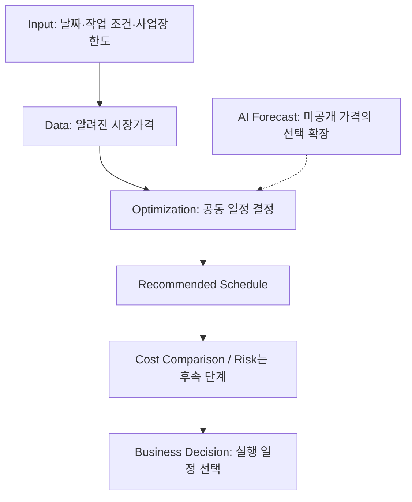
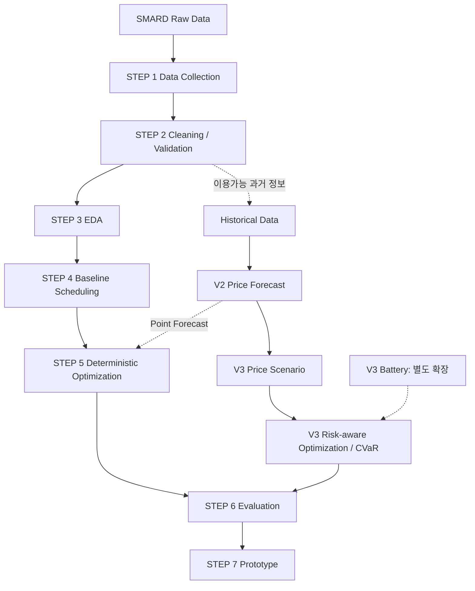
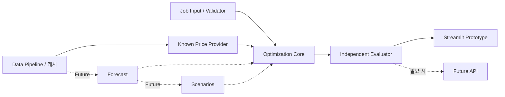

# Dovengers

## 작업 제약을 고려한 AI·데이터 기반 전력 사용 일정 최적화

*AI/Data-driven Electricity Scheduling under Operational Constraints*

기업이 해야 할 작업량은 그대로 유지하면서, 작업 마감과 사업장 최대 전력 사용량을 지키고 시간대별 전력가격으로 각 작업을 언제 수행해야 도매비용을 줄일 수 있는지 계산한다.

**현재는 repository 초기 개발 단계다. V1 Known Price Scheduling부터 구현한다.** 기존 조사에서 확인한 작은 PoC와 이 repository에 구현된 기능은 구분한다. 이 저장소의 Python 모듈은 아직 TODO이며, 예측·최적화·평가·UI가 완성된 상태가 아니다.

| 문서 | 목적 |
|---|---|
| [PROJECT_BRIEF](docs/PROJECT_BRIEF.md) | Ground Truth인 Technical Brief의 개발팀용 보존본: 수식·데이터·평가·한계 |
| [ROADMAP](docs/ROADMAP.md) | V1/V2/V3, 담당자, 선행조건, 완료 기준 |
| [PROGRESS](docs/PROGRESS.md) | 날짜별 작업·결정·실제 구현 상태 |

## Project Overview

프로젝트의 핵심은 **Known Price + Job Constraints → Scheduling Optimization → Baseline Comparison**이다. 전력가격이 이미 알려졌다면 그 가격으로 일정을 결정한다. 미래 가격을 아직 모르는 시점의 결정이 실제로 필요할 때만 가격예측의 추가 가치를 검증한다.

| 상태 | 의미 | 해당 내용 |
|---|---|---|
| ✅ Confirmed | 기존 Technical Brief에서 확인 | SMARD 확보, 실제 시간별 가격, 가상 3작업 계산, Greedy/전체 탐색 비교, 입력에 따른 일정 변화 |
| 🛠 Planned | 이 repository에서 개발할 V1 | 데이터 계약, validator, baseline, MILP, 독립 평가, Streamlit |
| ⚠️ Hypothesis / Not validated | 사용자·실험 검증 필요 | 실제 기업 절감률, ML의 Business Value, 작업 유연성, 고객 지불 의사, EMS 대비 우위 |
| 🚀 Future | 후속 검증·확장 | Forecast, Scenario, CVaR, Battery, 실제 계약·설비 연결 |

총 전기요금 절감·가격예측 우수성·실제 고객 검증·위험 감소는 현재 확인된 결과가 아니다.

### Quick Start

**현재 초기 개발 단계이며 실행 가능한 분석 파이프라인이나 Streamlit 앱은 아직 없다.**

`requirements.txt`는 V1의 개발 의존성 후보다. 전체 패키지 설치와 버전 호환성을 아직 검증하지 않았다. Python 3.11 이상을 초기 개발 기준 후보로 두고, 팀 공통 환경을 검증한 뒤 버전을 고정한다.

아래는 **향후 목표 명령이며 현재 작동하는 MVP 실행 안내가 아니다.**

```bash
# 향후: 의존성 설치 및 V1 구현 검증 후 안내를 업데이트한다.
pip install -r requirements.txt
streamlit run app/app.py
```

현재 읽어야 할 것은 README와 docs이며, `app/app.py`를 실행해도 결과를 계산하는 앱이 나오지 않는다. 테스트 파일에도 실제 테스트 함수가 아직 없으므로 테스트 통과를 주장하지 않는다.

## Problem Statement

전력가격이 시간마다 다르면 가장 싼 시간에 작업하면 된다고 생각하기 쉽다. 하지만 작업의 시간창과 사업장 전력 한도를 함께 고려해야 한다.

| 용어 | 쉬운 설명 |
|---|---|
| Release Time | 작업을 시작할 수 있는 가장 이른 시간 |
| Deadline | 작업이 완료되어야 하는 시각. 종료 경계는 배타적으로 처리 |
| Duration | 시작한 뒤 연속으로 실행해야 하는 시간 |
| MW | 작업이 가동 중 사용하는 전력 |
| Non-preemptive | 시작 후 중간에 끊지 않는 작업 |
| Site Power Limit | 동시에 사용하는 사업장 총 전력의 상한 |

한 작업이 싼 시간대를 차지하면 다른 작업의 연속 가동 구간이 사라질 수 있다. 따라서 개별 작업의 가장 싼 선택이 전체 최소비용 선택이 아닐 수 있다. 이 프로젝트는 여러 제약 아래 **전체 시작시간 조합을 결정하는 Decision Optimization** 문제다. 모든 작업을 완료하며 작업량을 줄여 비용을 낮추지 않는다.

## Why Now

전력 수요 유연성(Demand Flexibility)은 작업량을 유지하며 전력 사용 시간을 조정하는 능력이다. 재생에너지 확대와 수요 변화 속에서 유연한 수요의 중요성이 커지고 있다. 수요반응(Demand Response)은 가격·계통 조건에 맞춰 사용을 조정하는 활동이며, 본 프로젝트는 작업 시간 이동을 우선 다룬다. 공식 DR 시장 참여·보상금 계산은 현재 범위가 아니다. [IEA, Scaling Up Demand Flexibility (2026)](https://www.iea.org/reports/scaling-up-demand-flexibility/executive-summary)

유럽 하루전 시장은 2025-10-01부터 15분 가격으로 전환됐다. 더 세밀한 시간 선택이 중요해졌지만 현재 PoC는 2025년 상반기 **1시간 자료**에 기반한다. 최신 15분 시장을 이미 구현했다는 의미는 아니다. [SMARD, 15-minute wholesale prices](https://www.smard.de/en/15-minute-wholesale-prices-available-218078)

가격은 수요·풍력·태양광·연료·탄소·수출입·계통 조건 등에 영향을 받는다. 재생에너지가 많으면 무조건 싸진다고 단순화하지 않는다. 시간 이동이 실제 요금 절감으로 연결되려면 사용자의 가격노출 계약도 확인해야 한다.

## Target User & Business Decision

⚠️ **초기 사용자 가설:** 시간 이동이 일부 가능한 제조 보조공정·충전 작업·유연부하 사업장의 운영 담당자. 실증 대상 기업이나 유료 고객은 아직 검증되지 않았다.

핵심 질문은 **“오늘 수행해야 하는 각 작업을 몇 시에 시작할 것인가?”**이다.



V1 사용자는 일정·대안을 확인하고 채택 여부를 결정한다. 시스템이 실제 설비를 자동 제어하지 않는다. 날짜·가격·작업 조건이 달라질 때 반복 의사결정이 발생할 수 있다는 점은 Business Hypothesis다.

## Example

아래는 실제 기업 작업이 아닌 **Technical Brief의 가상 사업장**이다. 시간은 UTC, 작업 구간은 `[시작, 종료)`이며 24:00은 다음 날 00:00이다.

| 작업 | Release | Deadline | Duration | MW | 에너지 |
|---|---:|---:|---:|---:|---:|
| A | 00:00 | 12:00 | 4h | 1 | 4MWh |
| B | 00:00 | 24:00 | 6h | 1 | 6MWh |
| C | 08:00 | 24:00 | 3h | 1 | 3MWh |

**Site Power Limit = 1MW, 총 작업 에너지 = 13MWh.** 두 작업을 동시에 실행할 수 없으며 세 작업은 모두 완료해야 한다.

✅ 기존 PoC의 2025-01-15 실제가격 계산:

| 방법 | A | B | C | Wholesale Cost Proxy |
|---|---|---|---|---:|
| Cheapest Block Greedy | 00–04 | 18–24 | 12–15 | €2,323.84 |
| Joint Enumeration | 00–04 | 04–10 | 21–24 | €2,198.80 |

차이 €125.04는 **가상 작업의 도매비용 계산 차이**다. 기존 40개 완전 UTC 날짜 중 16일에 엄격한 비용차가 있었으며, 위 날짜는 최대 차이 사례를 사후 선택한 것이다. 일반 성능·실제 기업 절감률로 해석하지 않는다. A의 release만 04:00으로 바꾸면 최적 시작은 A=06, B=00, C=21로 달라지지만 이 경우 최적 비용은 같다.

**왜 Greedy와 다른가?** 설명용 네 슬롯 가격 `[5,1,2,10]`에서 A(1시간·마감3)와 B(2시간·마감4)가 1MW 한도를 공유한다고 하자. A를 슬롯1에 먼저 놓으면 B는 슬롯2·3을 써 총 €13이다. A를 더 비싼 슬롯0에 놓고 B를 슬롯1·2에 놓으면 총 €8이다. 이 수치는 **가상 교육용 반례**이며 SMARD 실험 성과가 아니다.

## Decision Problem

| 요소 | V1 정의 |
|---|---|
| Input | 가격 벡터, 날짜, 각 작업 release/deadline/duration/MW, site limit |
| Decision | 각 작업의 시작 슬롯 |
| Constraints | 각 작업 정확히 한 번, 시간창·연속가동·전력 상한 준수 |
| Objective | `Σ price[t] × load_mw[t] × interval_hours` 최소화 |
| 초기 가정 | UTC 24시간, 1시간 슬롯, 고정 MW, 기본부하 0, 배터리 없음 |

가격 단위는 €/MWh다. **MW × 시간 = MWh**이므로 간격을 곱해야 유로 비용이 된다. 15분 확장에서는 `interval_hours=0.25`를 적용한다. 작업 시작 후보는 `release … deadline-duration`이다. 작업을 삭제하거나 총 에너지를 줄이는 선택은 허용하지 않는다.

MILP의 이진변수 `x[i,s]`는 작업 i를 슬롯 s에서 시작하는지 나타낸다. 작업마다 합이 1이고, 각 시간에 실행 중인 작업의 MW 합이 상한 이하가 되도록 한다. 자세한 수식과 단계별 목적은 [Technical Brief 6장](docs/PROJECT_BRIEF.md#6-decision-problem-정의)을 참고한다.

## Data

| Dataset / Source | 관측 단위·변수 | 역할 | 접근·주의사항 |
|---|---|---|---|
| [SMARD / Bundesnetzagentur](https://www.smard.de/en/downloadcenter/download-market-data/) | 독일 시장 지역×시간 구간, price·load·wind·solar | **가격은 V1 핵심**. 부하·발전은 EDA 및 V2 후보 | 공개 다운로드. 기존 차트 JSON 수집 경로는 장기 API 호환 보장 아님 |
| [NASA POWER](https://power.larc.nasa.gov/docs/services/api/temporal/daily/) | 격자 지점×날짜, 기온·풍속·강수 | V2 추가 설명변수 후보 | 공개 API. 독일 한 지점 일별 자료는 전국·시간별·미래 예보가 아님 |

✅ 기존 작업공간에는 2025년 1~7월의 SMARD 결합자료 4,367행과 독일 지점 NASA 일자료가 확보되어 있다. **이 초기 저장소에는 원본 데이터·기존 실행 코드·결과를 아직 반입하지 않았다.** 기존 PoC는 문서에 기록된 외부 선행 실험이며 이 저장소에서 바로 실행되지 않는다.

🛠 Data 담당자는 출처·수집시각·단위·기간·라이선스·원본 파일명·변환 규칙을 기록하고 재현 가능한 수집을 구현한다. `data/raw/`, `data/processed/`는 데이터 파일을 기본적으로 Git에서 제외한다. 디렉터리 안내와 `.gitkeep`만 추적한다.

| 데이터 계약 | 필수 규칙 |
|---|---|
| Join Key | UTC 구간 시작시각 + 시장 지역 + 시간 간격. 기상은 지점·날짜·시간 기준 추가 |
| 단위 | 가격 €/MWh, 작업 MW, 구간 시간 h. 발전·부하 원본 MWh를 평균 MW와 구분 |
| 시간대 | V1 UTC. 독일 현지 `Europe/Berlin`은 DST에 23/25시간 하루 가능 |
| 음수 가격 | 시장 관측일 수 있으므로 임의로 0으로 자르지 않음 |
| 결측 가격 | V1 해당 날짜 계산을 거부. 미래 가격으로 채우지 않음 |
| NASA | 현재 저장본 LST 기준. UTC/현지 날짜로 무조건 Join하지 않음 |
| Forecast 정보 | `issued_at`, `available_at`을 관리. 미래 실제 기상·부하·발전은 예측 입력으로 사용 금지 |
| 출처 | SMARD CC BY 4.0 안내·기관 표기 보존, NASA 출처·메타데이터 보존 |

## AI vs Optimization

| 모듈 | 질문 | Output | 현재 repository 상태 |
|---|---|---|---|
| Prediction / AI | 미래 가격은 어떻게 될까? | Point Forecast·Quantile·Price Scenario | 🚀 필요성 확인 후 V2/V3 |
| Optimization | 그 가격에서 언제 작업할까? | 시작·종료·시간별 MW·목적값 | 🛠 V1 구현 예정 |
| Evaluation | 결정이 실제로 더 나았나? | 실제가격 Cost·위반·비용차·Regret | 🛠 독립 구현 예정 |

**Forecast → Optimization → Decision**을 구분한다. 가격이 이미 알려졌으면 Forecast 없이 Data → Optimization으로 간다.

| AI / 고급 분석 가치 | 검증할 내용 |
|---|---|
| Complexity Gain | 작업·시간창·연속가동·상한의 조합을 함께 탐색하는 최적화 가치 |
| Non-obvious Insight | 한 작업을 비싼 시간에 놓는 것이 다른 작업을 포함한 전체 비용을 낮출 수 있음 |
| Decision Improvement | 동일 작업·정보로 비교한 실제가격 비용·위반·regret 개선 |

공동 최적화 필요성과 가격예측 ML 필요성은 다르다. 공개된 하루전 가격을 다시 예측하는 ML을 보여주기 위해 추가하지 않는다.

## Project Pipeline



| STEP | Input → Output | Owner |
|---|---|---|
| 1 수집 | 공식 자료 → 원본·출처 기록 | 오성민 |
| 2 정제 | 원본 → UTC·단위·결측 검사된 파일 | 오성민 |
| 3 EDA | 정제 자료 → 가격·시간·부하·발전 관계 | 오성민 |
| 4 Baseline | 가격·동일 jobset → 단순 일정 | 남하원 |
| 5 Optimization | 같은 입력 → 공동 일정·solver 상태 | 남하원 |
| 6 Evaluation | 일정·실제가격 → 위반·비용·비교 | 오성민, 남하원 review |
| 7 Prototype | 입력·core → 결과 화면·오류 | 정병주 |

## Algorithms / Baselines

| 방법 | 목적·역할 | 사용하는 정보 | 상태 |
|---|---|---|---|
| Earliest Start | 마감순으로 가장 이른 가능한 시작, 운영 규칙 비교 | jobset·상한, 가격 미사용 | 🛠 Planned |
| Fixed Schedule | 사전에 정한 일정, 공통 feasibility 검사 | 가격을 보지 않고 정한 일정 | 🛠 Planned |
| Cheapest Block Greedy | 마감순으로 가장 싼 가능한 연속 블록, 되돌리기 없음 | 알려진 또는 같은 예측 가격 | ✅ 외부 PoC / 🛠 repo 이식 예정 |
| Enumeration / Brute Force | 모든 시작 조합, 작은 문제 정답 검증 | 알려진 가격·같은 제약 | ✅ 외부 PoC / 🛠 repo 이식 예정 |
| MILP | 이진 시작변수로 공동 최적화, 규모 확대 | 같은 가격·제약 | 🛠 Planned |
| Forecast + Optimization | 미공개 가격의 결정 비교 | 결정 당시 이용가능 정보 | 🚀 V2 |
| Scenario Optimization | 여러 가격 경로의 기대비용 | 검증된 시나리오 | 🚀 V3 |
| CVaR Optimization | 평균과 비싼 꼬리 비용의 trade-off | 같은 시나리오·위험 설정 | 🚀 V3 |

MILP는 혼합정수 선형계획이다. solver는 PuLP/CBC를 초기 후보로 두되 실행 검증 후 확정한다. 시간 초과의 실행가능 해는 최적해로 표시하지 않는다. `optimal / feasible / infeasible / timeout / error`를 구분한다.

모든 방법의 작업·release·deadline·duration·MW·site limit·간격이 같아야 한다. 예측 실험에서는 미래 실제가격 최적화가 **Perfect-information Oracle**이며 실행 가능한 예측 방법과 같은 정보 조건의 경쟁자가 아니다.

## Evaluation

| 구분 | Metric | 해석 |
|---|---|---|
| Feasibility | release·deadline·power limit violation | 미배치·중복·연속가동 위반도 함께 검사 |
| Cost | Wholesale Cost Proxy | `Σ 실제가격 × 총 MW × 시간간격` |
| Cost | Baseline Cost − Proposed Cost | 양수면 해당 조건에서 비용이 낮음 |
| Decision | Oracle Regret | 선택 일정 실현비용 − 같은 제약의 실제가격 최적 비용 |
| Peak | Maximum MW | 기본부하 포함 여부 표시 |
| Forecast | MAE·RMSE·Pinball Loss | V2 이후. 평균 오차와 분위수 오차 |
| Risk | CVaR·Tail Cost | V3 이후. 예측 시나리오와 test 실현 위험 구분 |

**도매비용 proxy는 실제 기업 총 전기요금이 아니다.** 망 이용료·세금·요금 계약·수요요금·정산 조건은 아직 반영하지 않았다. 비용이 0 또는 음수이면 퍼센트 절감률을 계산하지 않는다.

평가자는 optimizer와 별도로 제약과 비용을 다시 계산한다. Greedy 실패를 0비용 처리하거나 실패 날짜를 숨기지 않는다. 예측은 시간순 train/validation/test와 rolling backtest를 사용하고, 미래 관측·전처리·잔차 누수를 막는다. MAE가 좋아도 의사결정 비용이 좋아지는 것은 아니므로 동일 optimizer의 decision 평가가 필요하다.

### 주요 출력 — 목표 스키마, 아직 생성되지 않음

| 산출물 후보 | 포함할 내용 |
|---|---|
| 작업 일정 표 | job ID·start·end·MW·완료 여부 |
| 시간별 사용량 표 / 차트 | UTC timestamp·총 MW·상한 |
| 비용·baseline 비교표 | method·status·proxy cost·차이·peak·위반 |
| 평가 기록 | date·jobset·price mode·solver 상태·runtime·gap |
| V2/V3 예측·위험 기록 | issued_at·target·forecast·실제가격·regret·risk 설정 |

## MVP Roadmap

**V1이 필수이며 Forecast / CVaR / Battery는 후속 검증이다.**

| 버전 | Input | Engine | Output | 착수 조건 |
|---|---|---|---|---|
| V1 Known Price Scheduling | Date·Jobs·release·deadline·duration·MW·site limit | SMARD 가격·Baseline·Joint Optimization | Start/End·MW·Wholesale Cost Proxy·Greedy 비교·Feasibility | 지금 먼저 구현 |
| V2 Forecast + Optimization | 예측시점·대상 기간·이용가능 과거 정보 | 단순 예측 baseline·선택한 ML·동일 optimizer | 예측 일정·실제가격 비용·regret | 미공개 가격 의사결정의 필요성과 데이터 확인 |
| V3 Risk-aware Scheduling | 시나리오·α·λ, 선택적 battery 조건 | 확률 예측·Scenario·CVaR, 배터리는 별도 | 기대비용·꼬리위험·trade-off·충방전 | V2 검증 및 시나리오 보정 |

배터리 없이 CVaR를 먼저 비교하고 배터리는 그다음 추가한다. 피크 페널티 역시 기존 1MW 작업/1MW 상한 예시에선 최대 MW가 고정이므로 별도 입력·계약 가정이 필요하다. 자세한 일정은 [ROADMAP](docs/ROADMAP.md)에 있다.

## Business Hypothesis

⚠️ 고객·지불 의사·실제 경제 효과는 아직 검증되지 않았다.

| 질문 | 현재 가설 |
|---|---|
| Who uses? | 유연 제조작업·EV/산업 충전의 운영 담당자 |
| Who benefits? | 사업장의 일정 검토·구매비용 노출 관리 담당 조직 |
| Who pays? | 사업장 또는 Energy Management Service 사업자 후보. 아직 확인되지 않음 |
| 잠재 가치 | 반복 scheduling 지원, 가격노출 관리, 수작업 검토시간 감소 |
| 재사용 이유 | 작업 조건·가격·계획 기간 변경 |
| 확장 조건 | 실제 job flexibility·요금계약·기본부하·설비 제약 확보 |

향후 `기업 작업데이터 + 요금계약 + 전력시장 데이터 → 운영 Scheduling Decision Support`로 확장할 수 있는지 검증한다. 고정 단가 사용자에게 도매가격 기반 시간 이동 절감을 약속하지 않는다.

## System Architecture



V1은 Python·pandas·numpy·MILP 도구 한 개·Streamlit 중심으로 설계한다. API 분리가 필요하기 전에는 FastAPI를 추가하지 않는다. 예측 라이브러리도 V2 착수 때 고른다. UI에 계산을 중복 구현하지 않고 공통 core를 호출한다.

목표 함수 인터페이스(아직 미구현):

```python
solve_schedule(prices, jobs, site_limit, interval_hours, objective_config)
```

입력은 가격·작업·상한·시간간격·목적 설정이며, 출력 계약은 일정·solver 상태·비용·경고를 포함하도록 먼저 합의한다.

## Team

### 강산 — 국제금융

**Role: Business / Energy Market Lead**

- 글로벌·유럽 전력시장, Day-ahead Market, Demand Response / Demand Flexibility 조사
- 기업 전력비용·가격노출 계약 구조와 Target User 정의
- Business Model 가설, 기존 EMS / DR / 경쟁 서비스, 시장성·사업성 검토
- Why Now 근거 조사와 최종 발표 Business Storyline

핵심 질문: **“이 문제가 실제 비즈니스 문제인가? 누가 사용하며 왜 돈을 지불하는가?”**

첫 Task: 작업 시간을 옮길 수 있고 시간대 가격에 노출되는 사용자·계약 사례를 조사해, 확인한 근거와 아직 모르는 내용을 표로 작성한다.

### 오성민 — 경영 / 통계

**Role: Data / ML / Evaluation Lead**

- SMARD 수집·정제, Data Dictionary, EDA, Feature Engineering
- Baseline Forecast 및 필요성이 확인될 경우 가격예측 ML
- Time-based Validation, Decision-based Evaluation, optimizer 결과 독립 검증
- 통계적 실험 설계, Ablation / Backtest, 분석 결과 해석

핵심 질문: **“데이터상 실제 효과가 존재하는가? 모델 개선이 의사결정 개선으로 이어지는가?”**

첫 Task: 가격·UTC·시간간격·단위·결측·출처의 데이터 계약을 작성하고, 기존 2025-01-15 사례에 사용할 가격 24개를 검증한다.

### 남하원 — 컴퓨터공학

**Role: Optimization / Backend Lead**

- Job Constraint·Validator, Earliest / Fixed / Greedy, Enumeration 구현
- MILP Scheduling, solver 상태·infeasible 처리
- Optimization Core Function / 향후 API, Scenario / CVaR 확장

핵심 함수 후보: `solve_schedule(prices, jobs, site_limit, interval_hours, objective_config)`

핵심 질문: **“주어진 제약 아래 실제 최적 일정을 어떻게 계산할 것인가?”**

첫 Task: 시작 슬롯·마감·MW의 공통 입력/출력 계약을 오성민과 합의하고, 작은 enumeration·Greedy를 이식해 독립 평가와 연결한다.

### 정병주 — 컴퓨터공학

**Role: Prototype / Integration Lead**

- Repository·실행환경 관리, Streamlit Prototype·Job Input UI
- Data Pipeline ↔ Optimizer 연결, 시간별 MW·Schedule Timeline·Baseline Comparison
- Error / Infeasible Message, Demo 안정화, 필요 시 FastAPI / Deployment

핵심 질문: **“분석·최적화 결과를 실제 사용 가능한 기능으로 어떻게 보여줄 것인가?”**

첫 Task: 팀 공통 가상환경과 의존성을 검증하고, 실제 core 결과를 받을 화면 계약을 정한다. 아직 없는 결과를 가짜 모델 출력으로 표시하지 않는다.

### Cross Review

| 영역 | Owner | Reviewer |
|---|---|---|
| Business / Market | 강산 | 오성민 |
| Data / Forecast | 오성민 | 정병주 |
| Optimization | 남하원 | 오성민 |
| Evaluation | 오성민 | 남하원 |
| Prototype | 정병주 | 남하원 |
| Presentation / Competition | 강산 + 오성민 | 전원 |

**Optimizer 작성자가 Evaluation까지 단독으로 완료 승인하지 않는다.** 데이터·비용·제약 재계산을 다른 담당자가 검토한다.

## Repository Structure

```text
dovengers/
├── README.md
├── requirements.txt
├── .gitignore
├── data/
│   ├── README.md
│   ├── raw/.gitkeep
│   └── processed/.gitkeep
├── src/
│   ├── __init__.py
│   ├── data_pipeline.py
│   ├── contracts.py
│   ├── baselines.py
│   ├── optimizer.py
│   ├── evaluator.py
│   ├── forecast.py
│   └── scenarios.py
├── app/app.py
├── tests/
│   ├── test_optimizer.py
│   ├── test_constraints.py
│   └── test_evaluator.py
├── notebooks/README.md
├── outputs/.gitkeep
└── docs/
    ├── PROJECT_BRIEF.md
    ├── ROADMAP.md
    └── PROGRESS.md
```

| 파일 | 책임 / 상태 |
|---|---|
| `src/data_pipeline.py` | 수집·정제·가격 공급 / TODO |
| `src/contracts.py` | Job·가격·일정·결과 계약 / TODO |
| `src/baselines.py` | Earliest·Fixed·Greedy / TODO |
| `src/optimizer.py` | Enumeration·MILP / TODO |
| `src/evaluator.py` | 독립 feasibility·비용·regret / TODO |
| `src/forecast.py` | V2 / Future TODO |
| `src/scenarios.py` | V3 / Future TODO |
| `app/app.py` | V1 화면·연결 / TODO |
| `tests/test_*.py` | 의도만 기록된 테스트 계획. 실행 테스트 미구현 |

## Development Workflow

`main`에는 검토된 변경만 병합하고, 실행 코드가 생긴 뒤에는 항상 실행 가능한 상태를 유지한다. 현재 main은 문서와 scaffold만 있으며 “작동하는 MVP”를 의미하지 않는다.

1. 기능별 branch를 만든다: `feature/data`, `feature/forecast`, `feature/optimization`, `feature/prototype`, `research/business`.
2. 담당 영역의 코드를 개발하고 관련 계약·테스트·docs를 함께 수정한다.
3. Pull Request에 변경 목적·입출력·검증 결과·남은 한계를 적는다.
4. Cross Review 담당자가 확인한 뒤 main에 병합한다. branch는 사람 이름보다 기능 기준이다.

```text
feat: add greedy scheduling baseline
feat: implement milp scheduler
data: add smard cleaning pipeline
eval: add feasibility checker
docs: update business assumptions
fix: correct interval cost calculation
```

원본 데이터·기업 정보·토큰·`.env`·생성 결과를 무조건 commit하지 않는다. 소스와 문서의 라이선스는 팀이 아직 선택하지 않았으며, 데이터 이용 조건과 별개다.

## Current Status

2026-10-02 기준. 체크된 선행 조사 항목은 기존 Technical Brief를 뜻하며 repository의 구현 완료를 뜻하지 않는다.

- [x] Problem Definition — 기존 Brief
- [x] Dataset candidate validation — 기존 작업공간의 확보 확인
- [x] Small scheduling PoC — 외부 선행 실험
- [x] Repository directory / module scaffold
- [x] README / Team / Roadmap 작성
- [ ] Repository core refactoring / 기존 PoC 이식
- [ ] Shared data contract 구현
- [ ] Baseline implementation
- [ ] MILP implementation
- [ ] Evaluation pipeline
- [ ] Streamlit V1
- [ ] Business validation
- [ ] Forecast necessity test
- [ ] Risk-aware scheduling

상태 변경은 [PROGRESS](docs/PROGRESS.md)에 날짜·근거·남은 일을 기록한다.

## Risks & Limitations

- 가격이 알려져 있으면 ML 예측의 필요성이 약하다. 최적화의 가치와 ML의 가치를 따로 검증한다.
- 실제 전기요금·요금계약·기본부하·공정 선후관계·안전·전환 비용은 아직 미반영이다.
- 가상 작업의 feasibility는 실제 기업 작업 유연성 검증이 아니다.
- Greedy보다 좋은 것이 상용 EMS·optimizer보다 좋다는 의미는 아니다.
- 독일 자료를 한국 요금·시장에 바로 일반화할 수 없다.
- 시간 간격·DST·MWh/MW·관측/예보 혼동은 비용 오류와 정보 누수를 만든다.
- Forecast / CVaR / Battery의 성능·실제 위험 감소는 검증되지 않았다.
- 기존 작은 PoC는 사후 최적화이며 대표 날짜가 사후 선택됐다. prospective 성능이 아니다.

## Next Steps

1. **오성민 + 남하원:** 공통 시간·단위·Job/Result 계약부터 합의.
2. **오성민:** SMARD 데이터의 재현·출처·결측·UTC 검증.
3. **남하원:** baseline·enumeration·validator → 독립 평가 연결 → 작은 MILP 검증.
4. **정병주:** 환경 확인 → 실제 core와 연결된 입력·일정·비용·오류 화면.
5. **강산:** 사용자·가격노출 계약·경쟁 기능·공고 AI 요건 검증.
6. 전원: V1 완료 후에만 Forecast의 필요성과 우선순위를 결정.

README 정보 구조는 [kamp-power-peak-forecast main README](https://github.com/nepersoned/kamp-power-peak-forecast/blob/main/README.md)를 참고했다. 해당 프로젝트의 데이터·모델·코드·성과는 복사하거나 Dovengers 결과로 사용하지 않았다.
