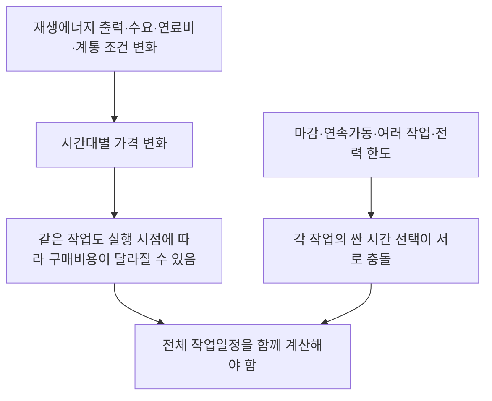
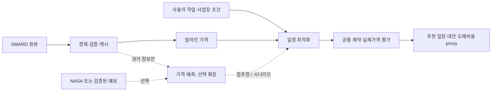
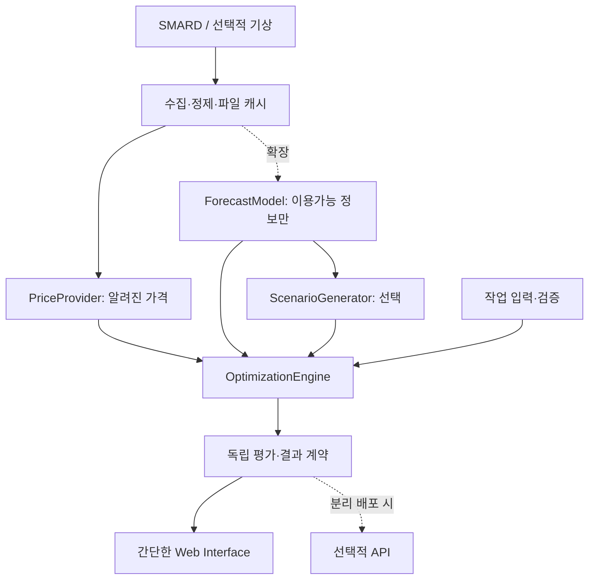

> Repository 보존본 · 반입일 2026-10-02. 원본 작성일과 과거 계획은 그대로 유지한다. 현재 개발 상태·일정은 [PROGRESS](PROGRESS.md)와 [ROADMAP](ROADMAP.md)를 따른다. 로컬 절대경로 링크만 저장소 밖 선행 파일 설명으로 바꾸었다.

# 작업 제약을 고려한 전력 사용 일정 결정

## 팀 내부 개발용 Technical Project Brief

작성일: 2026-10-01 · 적용 범위: `report_mvp_selection.md` 종합 1순위만 · 제출 마감: 2026-10-05

**한 문장 설명:** 반드시 해야 하는 작업은 그대로 수행하면서, 작업 마감과 사업장 전력 한도를 지키도록 시작 시간을 함께 계산해 전력 구매비용을 줄일 수 있는 일정을 찾는 프로젝트다.

**이 문서의 사실 기준:** 원본 `technical_project_brief_power_scheduling.md`의 내용이 Ground Truth다. 선행 선정 보고서 `report_mvp_selection.md`, PoC 코드 `work/mvp_core_probe.py`, 결과 `outputs/mvp_selection/core_probe_results.json`는 기존 조사 작업공간의 파일이며 이 repository에 아직 반입하지 않았다. 원본의 사실·계획·가설 구분을 유지한다. 외부 자료는 시장 제도와 데이터 처리의 보충 근거다.

| 표시 | 의미 | 이 문서에서 해당하는 내용 |
|---|---|---|
| **[확인됨]** | 선정 보고서에 기록되고 기존 파일로 확인되는 사실 | SMARD 데이터 확보, 가상 작업 3개에 대한 전체 일정 탐색과 Greedy 비교 |
| **[보충 확인]** | 이번 문서 작성 중 공식 문서 또는 저장 데이터 메타데이터로 확인한 사항 | 현재 시장의 15분 가격, NASA 시간 기준, 가격·에너지 단위 |
| **[개발 설계]** | 팀이 앞으로 구현할 명세이며 현재 구현 완료를 뜻하지 않음 | 입력 검증, MILP, 평가 자동화, 인터페이스 |
| **[미검증 가설]** | 실험 또는 실제 사용자 검증이 필요한 주장 | ML이 운영 결정을 개선한다는 주장, 실제 기업의 비용 절감·지불 의사 |
| **[추후 확장]** | 초기 MVP의 필수 범위 밖 | 가격분포·CVaR·배터리·실제 요금 계약·설비 연결 |

**현재 약속할 수 있는 것:** 알려진 가격과 명시적인 작업 조건으로 서로 다른 실행가능 일정을 계산하는 작은 core가 있다. **현재 약속할 수 없는 것:** 학습된 가격예측 모델의 성능, 실제 기업 전기요금 절감률, 상용 최적화 제품보다 우수하다는 결론, 가격위험 감소 효과.

---

## 1. 프로젝트 한눈에 보기

### 1.1 30초 설명

전력시장 가격은 시간마다 달라지지만, 기업은 모든 작업을 가장 싼 시간에 몰아서 실행할 수 없다. 작업마다 시작 가능한 시간, 완료 마감, 연속 가동시간이 있고 여러 작업이 사업장 전력 한도를 함께 사용하기 때문이다. 우리는 같은 작업량을 유지하면서 전체 작업의 시작 시간을 동시에 계산한다. 먼저 이미 알려진 가격으로 일정 최적화를 구현하고, 가격을 아직 모르는 시점의 의사결정이 실제로 필요하다고 확인되면 가격예측과 위험관리 기능을 추가한다. 계산된 비용은 도매전력 구매비용의 대리값이며 실제 기업 총 전기요금은 아니다.

### 1.2 조금 더 정확한 기술적 설명

**[개발 설계]** 비중단 작업(non-preemptive job: 시작하면 정해진 시간 동안 계속 실행하는 작업)의 시작 시각을 결정하는 전력비용 최소화 문제다. 작업별 시간창과 소비전력, 사업장 총 전력 상한을 제약으로 둔다. 초기에는 실제 SMARD 가격 벡터를 입력하는 결정론적 일정 최적화를 구현한다. 이후에는 미래 가격을 추정하는 **Forecast(예측)**와, 그 정보로 행동을 선택하는 **Optimization(최적화)**을 별도 모듈로 연결한다.

| 구분 | 현재 core | 개발 목표 | 아직 검증할 사항 |
|---|---|---|---|
| 데이터 | 실제 독일 SMARD 시간별 가격·부하·풍력·태양광 | 일관된 시간·단위·출처 계약 | 장기간·15분 최신 자료로 확장할 때 품질 |
| 작업 | 가상 작업 3개, 사업장 1MW | 사용자가 작업 조건을 변경 | 실제 작업 유연성·공정 제약 |
| 계산 | Greedy와 전체 시작시간 탐색 | MILP 및 결과 검증 | 예측·위험관리가 추가로 주는 가치 |
| 결과 | 일정, 시간별 MW, 도매비용 proxy | 입력에 반응하는 화면·비교표 | 실제 요금·현장 효과 |

**팀의 첫 개발 목표:** 가격예측 모델을 많이 만드는 것보다, 데이터와 입력 제약을 올바르게 해석하는 최적화 core를 완성한다.

## 2. 문제의식

**Flexible Load(유연 전력부하)**는 수행할 작업량을 바꾸지 않고 사용 시간을 일부 옮길 수 있는 전력 수요다. 예를 들어 특정 시간창 안에서 실행 가능한 세척·가열·충전 작업을 생각할 수 있다. 모든 제조공정이 유연한 것은 아니며, 이 예시가 실제 사용자를 확보했다는 뜻도 아니다.

**Demand Response(수요반응)**는 가격이나 계통 상황에 맞춰 전력 사용 시점·크기를 조정하는 활동이다. 본 MVP는 그중 작업 시간을 이동시키는 계산을 다룬다. 공식 수요반응 시장에 참여하거나 보상금을 계산하는 기능은 포함하지 않는다.



재생에너지는 가격 변화의 한 요인이다. 가격은 수요, 연료·탄소 가격, 수출입, 발전소·계통 조건 등에도 영향을 받으므로 “재생에너지가 많으면 무조건 싸다”를 모델의 결론으로 미리 정하지 않는다.

“가장 싼 시간을 고른다”는 규칙은 작업이 하나이고 그 시간에 작업을 완료할 수 있다면 충분할 수 있다. 그러나 가장 싼 **한 시간**과 가장 싼 **연속 네 시간**은 다르다. 두 작업이 같은 시간대를 원하면 한 작업의 선택이 다른 작업의 비용과 실행가능성을 바꾼다. 따라서 가격 조회가 아니라 **서로 연결된 제약 아래의 의사결정**이다.

또한 시간대별 도매가격에 노출되는 요금 계약이어야 비용 이동의 가치가 직접 나타난다. 고정 단가 계약이라면 이 가격만으로 시간 이동에 따른 실제 절감을 주장할 수 없다.

**다음 행동:** 초기 대상 작업은 “시간 이동 가능·연속 가동·고정 MW” 조건을 만족한다고 명시하고, 그 밖의 공정은 범위에서 제외한다.

## 3. 왜 지금 중요한가

**[보충 확인]** IEA의 2026년 수요 유연성 보고서는 전력 수요와 재생에너지 확대 과정에서 수요 유연성이 계통 운영과 비용에 중요한 역할을 한다고 설명한다. 이 프로젝트는 그 배경을 활용하지만 IEA의 효과를 우리 모델의 성능으로 가져오지 않는다. [IEA, Scaling Up Demand Flexibility — Executive Summary](https://www.iea.org/reports/scaling-up-demand-flexibility/executive-summary)

독일을 포함한 유럽 하루전 시장은 **2025-10-01부터 15분 단위 가격**으로 전환됐다. 이는 더 세밀한 사용 시간 선택이 중요해지는 배경이면서, 우리 데이터 처리의 시간 간격을 고정 가정하면 안 되는 이유다. 현재 PoC의 2025년 상반기 **시간 단위** 자료와 2026년 시장의 원래 해상도를 구분해야 한다. [SMARD, 15-minute wholesale prices available](https://www.smard.de/en/15-minute-wholesale-prices-available-218078)

**Day-ahead price(하루전 가격)**는 다음 날 공급될 전력에 대해 전날 시장에서 결정하는 가격이다. 가격이 공개된 뒤 그 가격으로 전력을 구매하는 의사결정이라면 다음 날 가격을 ML로 다시 예측할 이유가 약하다. 반면 가격 공개 전에 작업을 확정하거나 아직 가격이 없는 다음 기간까지 계획해야 한다면 불확실성을 다룰 필요가 생긴다. 후자의 실제 운영 필요성은 **[미검증 가설]**이다.

| 시의성 근거 | 프로젝트에 연결되는 부분 | 연결하면 안 되는 주장 |
|---|---|---|
| 수요 유연성의 중요성 | 유연 작업의 가치를 계산하는 문제 | 모든 공장이 유연하거나 비용 절감이 보장됨 |
| 15분 시장 전환 | 시간 간격을 명시하는 데이터·모델 설계 | 현재 core가 이미 15분 운영을 검증함 |
| 가격 불확실성이 존재하는 의사결정 | 공개 전 예측·시나리오 검증의 후보 | 이미 알려진 하루전 가격도 ML이 꼭 필요함 |

**다음 행동:** 마감까지는 확보된 2025년 시간별 자료로 구현하고, 최신 15분 자료는 별도 데이터 변환 검증 후 연결한다.

## 4. 실제 사용자와 의사결정

**[개발 설계 / 사용자 가설]** 초기 사용자는 시간 이동 가능한 작업을 운영하는 사업장의 운영 담당자다. 현재 실증 대상 기업은 확보·검증되지 않았다. “실제 사용자”는 이 프로젝트에서 누가 어떤 결정을 할지 구체적으로 정의한다는 의미다.

| 항목 | 초기 정의 |
|---|---|
| 사용자 | 다음 날 작업 시작시간을 정하는 운영 담당자 |
| 대상 | 충전 또는 일부 제조 보조 작업처럼 시간창 안에서 연속 실행 가능한 작업 |
| 결정 | 각 작업을 언제 시작할 것인가 |
| 유지해야 하는 것 | 작업 개수·완료 여부·작업별 총 소비량 |
| 현재 대응의 비교 대상 | 고정 일정, 가능한 즉시 시작, 마감 순서에 따른 싼 블록 선택 |
| 반복 사용 이유 | 날짜별 가격과 작업 조건이 달라짐 |
| 경제적 해석 | 동일 작업 조건에서 도매비용 proxy 차이를 계산 |
| 현장 적용에 추가로 필요한 것 | 요금 계약, 기본부하, 공정 순서, 설비 운전·안전·전환 제약 |

사용자는 작업 조건을 입력하고, 추천 일정이 실행가능한지 확인한 뒤 실제 운영 일정 채택 여부를 판단한다. MVP는 설비를 자동 제어하지 않는다. 가상 작업으로 계산 기능을 보여주는 것과 실제 현장에서 실행 가능한 계획을 제공하는 것은 다른 검증 단계다.

**다음 행동:** 초기 사용 사례는 “독일 가격을 이용한 가상 유연 작업 사업장”으로 고정하고, 제조설비·EV 충전 가운데 실제 인터뷰 대상은 별도로 찾는다.

## 5. 구체적인 Example

### 5.1 기존 PoC와 같은 가상 사업장

아래 작업은 실제 기업의 작업 데이터가 아닌 **가정 입력**이다. `release`와 `deadline`은 UTC 하루의 시간 슬롯으로 표시한다. 작업 구간은 `[시작, 종료)`이며 24는 다음 날 00:00이다.

| 작업 | Release Time: 실행 가능 시점 | Deadline: 완료 마감 | Duration: 필요한 연속 가동시간 | 소비전력 | 소비에너지 |
|---|---:|---:|---:|---:|---:|
| A | 00:00 | 12:00 | 4시간 | 1MW | 4MWh |
| B | 00:00 | 다음 날 00:00 | 6시간 | 1MW | 6MWh |
| C | 08:00 | 다음 날 00:00 | 3시간 | 1MW | 3MWh |

**Site Power Limit(사업장 전력 상한)**은 동시에 사용할 수 있는 총 전력의 한도다. 여기서는 1MW이므로 두 작업을 동시에 실행할 수 없다. 총 작업 에너지는 어떤 실행가능 일정을 선택해도 **13MWh**다.

| 기존 규칙 | 시스템이 함께 계산하는 것 |
|---|---|
| 마감이 빠른 A부터 싼 연속 구간을 먼저 차지함 | A의 선택이 B·C에 남기는 시간까지 고려 |
| 한 작업을 배치한 뒤 다음 작업을 배치함 | 모든 작업의 시작시간 조합을 비교 |
| 실패하면 뒤 작업을 못 넣거나 수동 조정 | 전체 조건에서 실행가능 해가 있는지 확인 |

### 5.2 “조금 더 비싼 시간”이 전체 비용을 낮추는 설명용 반례

**[설명용 가상 예시 — 실제 SMARD 실험 성과가 아님]** 1시간 슬롯 네 개의 가격이 다음과 같다고 하자.

| 슬롯 t | 0 | 1 | 2 | 3 |
|---|---:|---:|---:|---:|
| 가격 €/MWh | 5 | 1 | 2 | 10 |

작업 A는 `release=0, deadline=3, duration=1, MW=1`, 작업 B는 `release=0, deadline=4, duration=2, MW=1`, 사업장 상한은 1MW다.

| 방식 | A 일정 | B 일정 | 총 도매비용 proxy |
|---|---|---|---:|
| 마감 우선 Cheapest Block Greedy | `[1,2)` | `[2,4)` | 1 + 2 + 10 = €13 |
| 전체 일정 최적화 | `[0,1)` | `[1,3)` | 5 + 1 + 2 = €8 |

A를 자기에게 가장 싼 슬롯 1에 놓으면 B가 싼 두 시간 연속 구간을 쓰지 못한다. A가 조금 더 비싼 슬롯 0을 양보받는 대신 B가 슬롯 1·2를 쓰면 전체 비용은 더 낮다. 이 반례는 **공동 최적화가 필요한 이유**를 설명하며 가격예측 ML의 필요성을 증명하지 않는다.

**다음 행동:** 이 네 슬롯 반례와 기존 실제가격 사례를 각각 교육용·회귀 검증용으로 보관한다.

## 6. Decision Problem 정의

### 6.1 Input · Decision Variable · Constraint · Objective

| 요소 | 내용 | 초기 범위 |
|---|---|---|
| Input | 시간별 가격, 작업 조건, 전력 상한 | 실제 가격 + 가상 또는 사용자 입력 작업 |
| Decision Variable | 작업 i의 시작 슬롯 | 작업별로 하나의 시작시간 |
| Constraint | release·deadline·duration·상한·모든 작업 완료 | 중단 없는 고정 MW 작업 |
| Objective Function | 평가하고 최소화할 비용 함수 | 도매비용 proxy부터 시작 |

시간 슬롯을 `t=0,…,T−1`, 간격을 `Δt`시간으로 둔다. 초기에는 `T=24, Δt=1`이다. 작업 i의 `r_i`는 release, `D_i`는 완료 마감, `d_i`는 연속 가동 슬롯 수, `p_i`는 MW다. 실제 지속시간은 `d_i × Δt`다.

작업의 허용 시작시간은 다음과 같다.

\[
S_i=\{r_i,r_i+1,\ldots,D_i-d_i\}.
\]

쉬운 설명: 마감까지 모든 가동시간이 들어가는 시작시간만 후보로 둔다. `deadline=12, duration=4`라면 가장 늦은 시작은 8이며 종료는 12다.

`x_{i,s}`는 작업 i가 슬롯 s에서 시작하면 1, 아니면 0인 이진변수다.

\[
\sum_{s\in S_i}x_{i,s}=1,\qquad x_{i,s}\in\{0,1\}.
\]

쉬운 설명: 각 작업을 정확히 한 번 수행한다. 비용이 비싸다고 작업을 삭제하거나 작업량을 줄이지 않는다.

시간별 전력은 다음과 같이 계산한다.

\[
L_t=b_t+\sum_i p_i\sum_{s\in S_i:\,s\le t<s+d_i}x_{i,s},\qquad L_t\le P_{\max}.
\]

쉬운 설명: 그 시간에 가동 중인 작업의 MW를 더하고 사업장 상한을 넘지 않게 한다. `b_t`는 이동할 수 없는 기본부하이며 초기 MVP에서는 **0으로 가정**한다. 실제 공장에서는 기본부하를 제외한 잔여 용량을 계산해야 한다.

**초기 제외:** 작업 간 선후관계, 설비 공유·교체시간, 작업 중단, 가변 MW, 배터리, 자체 발전, 예비전력. 이 변수들은 현장 요구를 확인한 뒤 추가한다.

### 6.2 목표함수 단계

#### 단계 1 — 전력비 최소화 [개발 설계]

\[
C(x;\pi)=\sum_t \pi_t L_t\Delta t,\qquad \min_x C(x;\pi).
\]

`π_t`는 €/MWh, `L_t`는 MW, `Δt`는 시간이다. 따라서 **가격 × 전력 × 시간 = 유로 비용**이다. 기존 코드는 1시간 간격이라 `Δt=1`을 생략한 형태다. 15분 간격으로 바꾸면 반드시 `Δt=0.25`를 적용한다.

#### 단계 2 — 비용 + 피크 페널티 [추후 확장]

\[
\min_x C(x;\pi)+\beta z,\qquad z\ge L_t\quad\forall t.
\]

`z`는 최대 MW, `β`는 €/MW 단위의 설정된 페널티다. 전력 상한이라는 **하드 제약**과, 상한 이내에서도 피크를 줄이려는 **소프트 목적**은 다르다. 이 페널티는 계약을 확인하기 전에는 실제 수요요금으로 해석하지 않는다. 기존 1MW 작업·1MW 상한 사례는 피크가 항상 1MW이므로 피크 항을 넣어도 비교가 달라지지 않는다. 피크 실험에는 다른 MW 작업 또는 기본부하를 가진 별도 가정 사례가 필요하다.

#### 단계 3 — 기대비용 + 가격위험 [추후 확장]

**Scenario(시나리오)**는 가능한 미래 가격 경로 하나다. 시나리오 k의 가격으로 계산한 비용을 `C_k(x)`, 발생 가중치를 `q_k`라고 두고 `Σq_k=1`로 둔다.

\[
\min_x\sum_k q_k C_k(x)+\lambda\operatorname{CVaR}_{\alpha}(C(x)).
\]

**CVaR(조건부 위험가치)**는 비용이 크게 나오는 상위 꼬리 구간의 평균을 나타내는 위험 지표다. 예를 들어 α=0.95는 비싼 쪽 상위 5%의 비용을 다루려는 설정이다. 유한 시나리오에서는 다음 보조변수로 구현할 수 있다.

\[
\operatorname{CVaR}_{\alpha}=\eta+\frac{1}{1-\alpha}\sum_k q_k u_k,
\quad u_k\ge C_k(x)-\eta,\quad u_k\ge0.
\]

`η`는 꼬리 비용의 기준을 정하는 보조변수, `u_k`는 그 기준을 넘는 비용이다. 둘 다 유로 단위이고 `λ`는 위험을 얼마나 중시할지 정하는 무차원 가중치다. **모든 시나리오에서 동일한 일정 x를 선택**해야 한다. 각 미래를 미리 알고 다른 일정을 고르면 현재 결정의 위험관리 검증이 아니다.

위험을 중시한다고 평균 비용까지 항상 낮아지는 것은 아니다. 더 높은 평균 비용을 감수하고 비싼 경우의 부담을 줄이는 선택일 수 있다. 모든 가격이 이미 알려져 있거나 모든 시나리오가 같다면 이 위험모형의 추가 가치는 없다. 기대비용만 최소화하는 선형 비용 모형은 평균 가격으로 최적화한 것과 같으므로, 시나리오를 많이 만들었다는 사실 자체가 새로운 의사결정을 만들지는 않는다.

**단계적 개발 이유:** 먼저 제약과 비용 계산의 정합성을 증명하고, 그 뒤 추가 항이 정말 다른 선택과 이익을 만드는지 분리 평가할 수 있다.

**다음 행동:** 위 시간 인덱스와 단위, 마감의 배타적 종료 정의를 데이터·최적화·화면 담당자가 공통 계약으로 채택한다.

## 7. 데이터 설명

### 7.1 현재 데이터 자산

| Dataset | 제공기관 / 공식 경로 | 관측 단위·Frequency | 사용할 변수 | Join Key | 역할·현재 상태 |
|---|---|---|---|---|---|
| SMARD | 독일 연방네트워크청 Bundesnetzagentur / [다운로드](https://www.smard.de/en/downloadcenter/download-market-data/) | 시장 지역 × 시간 구간. 기존 확보본은 시간 단위 | `price`, `load`, `wind`, `solar` | UTC 구간 시작시각 + 지역 + 간격 | **[확인됨]** 최적화의 핵심 가격 자료. 나머지는 EDA·미래 예측 후보 |
| NASA POWER | NASA / [Daily API 문서](https://power.larc.nasa.gov/docs/services/api/temporal/daily/) | 격자 지점 × 날짜. 현재 독일 지점 자료는 일 단위 | T2M 기온 °C, PRECTOTCORR 강수 mm/일, WS10M 풍속 m/s | 지점·날짜·시간 기준 | **[확인됨]** 접근 가능한 기상 자료. **[추후 확장]** 가격·수요 예측 설명변수 후보 |

SMARD는 무료 공개 자료이며 공식 다운로드 페이지에 CC BY 4.0 조건이 안내돼 있다. NASA POWER도 공개 API로 받을 수 있다. 데이터 출처·라이선스 표시와 수집시각을 보존한다. [SMARD 공식 다운로드 및 이용 조건](https://www.smard.de/en/downloadcenter/download-market-data/)

| 로컬 파일 | 확인된 범위 | 해석 |
|---|---|---|
| `outputs/problem_first/data/smard_joined.csv` | 네 시계열을 공통 시간으로 결합한 4,367행, 2025년 1월~7월 | 중복·결측·완전한 날짜를 다시 검사해 평가용으로 고정 |
| `outputs/business_decision/data/nasa_de_daily.json` | 독일 지점 위도 50·경도 10, 2010~2025 일 자료 | 독일 전체 기상 또는 다음 날 기상예보가 아님 |
| 기존 SMARD JSON 수집본 | 시계열별 원본·주별 파일 | CSV 재현 및 출처 추적에 사용 |

선정 보고서에 있는 2026년 9월의 별도 SMARD 표본은 장기 CSV와 구분한다. 최신 일부 날짜를 확보했다는 사실과 장기간 예측 검증이 가능한 학습 자료를 확보했다는 사실은 다르다.

### 7.2 수집 방식과 데이터 계약 [개발 설계]

기존 수집 코드가 사용한 SMARD 차트 경로는 다음 형태다.

```text
https://www.smard.de/app/chart_data/{code}/DE/index_hour.json
https://www.smard.de/app/chart_data/{code}/DE/{code}_DE_hour_{timestamp}.json
price=4169 / load=410 / wind=4067 / solar=4068
```

이 경로는 기존에 실제 자료를 받은 웹 차트 엔드포인트이며, 장기 호환성이 보장된 공식 버전 API로 취급하지 않는다. 캐시·재시도·스키마 검사를 두고 공식 다운로드를 대체 경로로 남긴다. `wind`는 기존에 선택한 풍력 시계열이다. 정확한 발전 범주를 메타데이터로 확인하기 전에는 “풍력 전체 합계”로 표시하지 않는다.

| 필드 | 표준화 후 의미 | 주의사항 |
|---|---|---|
| `timestamp_utc` | 구간 시작 UTC 시각 | 원본 epoch ms를 timezone-aware datetime으로 변환 |
| `interval_hours` | 구간 길이 | 1시간과 15분을 혼합하지 않음 |
| `price_eur_mwh` | 도매가격 €/MWh | 가격을 에너지량처럼 합산하지 않음 |
| `load_mwh`, `wind_mwh`, `solar_mwh` | 해당 구간의 에너지량 | 원본 단위를 확인 후 이름 확정 |
| `load_mw` 등 | 평균 전력 = 구간 MWh / 구간 시간 | 1시간일 때만 MWh 수치와 평균 MW 수치가 같음 |
| `region`, `source`, `fetched_at` | 지역·출처·수집시각 | 사업장 계량값과 국가·시장 집계값 구분 |
| `available_at` | 의사결정 시점에 실제 알 수 있었던 시각 | 예측용 자료에는 필요. 없는 경우 미래 사용을 허용하지 않음 |

**[보충 확인]** SMARD의 부하·발전 표시는 구간 에너지 MWh를 사용한다. 시장의 부하·발전은 개별 사업장 소비·자가발전이 아니다. [SMARD 시장 데이터 안내](https://www.smard.de/en)

### 7.3 시간대·결측·기상 처리

1. **UTC와 독일 현지 시간을 구분한다.** 기존 PoC는 UTC 날짜의 24시간이다. 독일 현지 날짜는 `Europe/Berlin`이며 서머타임 전환일에는 23 또는 25시간일 수 있다. 초기 재현은 UTC로 고정하고 화면에 표시한다. 현지 하루 단위 운영 확장은 실제 timestamp 목록으로 모델링한다.
2. **음수 가격은 임의 제거하지 않는다.** 실제 시장 현상일 수 있다. 0 이하 비용에서는 퍼센트 절감률이 오해를 만들므로 절대 비용차를 우선한다.
3. **가격 결측일은 초기 계산에서 거부한다.** 결과를 만들기 위해 미래 가격으로 보간하지 않는다. 예측 설명변수 결측은 학습 구간에서 정한 규칙과 결측 플래그로 처리한다.
4. **NASA 저장본은 LST 기준이다.** LST는 지점의 태양시 기준으로 UTC나 독일 민간 표준시와 다르다. 현재 파일의 메타데이터를 보존하고, 엄격한 날짜 Join이 필요하면 `time-standard=UTC`를 명시해 재수집한다. [NASA Daily API의 시간 기준](https://power.larc.nasa.gov/docs/services/api/temporal/daily/)
5. **일 단위 기상은 시간별 변동을 표현하지 못한다.** 하루 값을 24시간에 반복한다고 시간별 기상예보가 생기지는 않는다. 한 지점 기상만으로 독일 전체 풍력·태양광 출력을 대표한다고 가정하지 않는다.
6. **실제 관측과 예보를 구분한다.** 다음 날의 실제 기상, 실제 부하, 실제 풍력·태양광을 전날 가격예측에 넣으면 미래 정보 누수다. 현재 네 SMARD 시계열과 NASA 저장본을 자동으로 “미래 예보”로 취급하지 않는다. 사용 시점에 알 수 있던 과거값이나 별도로 확보·검증한 예보만 사용한다.

### 7.4 이 가격이 뜻하지 않는 것

SMARD 시장가격은 기업의 총 소매 전기요금이 아니다. 망 이용료, 세금, 공급 계약, 수요요금, 손실·정산 조건 등은 현재 계산에 없다. 출력 이름은 **Wholesale Cost Proxy(도매비용 대리값)**로 통일한다. 독일 데이터를 한국 기업의 요금 절감으로 곧바로 해석하지 않는다.

**다음 행동:** 원본 보존 → UTC 정규화 → 단위 검증 → 완전한 날짜 목록 생성 → 버전이 고정된 가격 파일 저장 순서로 데이터 계약을 완성한다.

## 8. 전체 Pipeline

우선순위 `P0`는 최초 MVP 필수, `P1`은 core 안정화 후, `P2`는 예측 필요성이 확인된 뒤다. 아래는 **[개발 설계]**이며 현재 완료 상태는 1·5의 작은 일부뿐이다.

| STEP | Input | Output | 필요한 기술·검사 | 우선순위 |
|---|---|---|---|---|
| 1. Data Collection | 기존 SMARD 파일·출처 경로 | 캐시된 원본, 출처·수집 기록 | requests, 파일 캐시, 응답·스키마 검사. NASA는 선택 | P0 |
| 2. Cleaning | 원본 가격·부하·발전 | UTC·단위가 일치하는 시계열 | pandas, 중복·결측·간격 검사, 음수 가격 확인 | P0 |
| 3. EDA | 정제 자료 | 가격 분포·시간대·요일·부하·발전 관계 | 기초 통계·시각화, 상관을 인과로 해석하지 않음 | P1 |
| 4. Baseline Scheduling | 가격, 동일 작업 조건 | Earliest·Fixed·Greedy 일정과 상태 | 공통 feasibility checker | P0 |
| 5. Deterministic Optimization | 알려진 가격, 작업, 상한 | 공동 최적 일정·비용·solver 상태 | 작은 문제 enumeration, 이후 MILP | P0 |
| 6. Price Forecasting | 시점별 이용가능 과거 정보 | 미래 가격 점추정·quantile | 시간순 분할, 단순 모델→선택한 ML 한 개 | P2 |
| 7. Uncertainty Modeling | 과거의 시간순 예측 잔차·분위수 | 상관을 보존한 일별 가격 시나리오 | 잔차 경로 표본추출, 구간 보정 | P2 |
| 8. Risk-aware Optimization | 시나리오, 작업, 위험 설정 | 기대비용·CVaR 비교 일정 | 공통 일정의 시나리오 MILP | P2 |
| 9. Evaluation | 모든 일정, 동일 실제 가격·제약 | feasibility·비용차·regret·위험 평가 | 날짜별 paired 비교, 실패도 기록 | P0부터 |
| 10. Prototype | 날짜·작업 입력 | 일정·시간별 MW·비교표·오류 메시지 | 초기 Streamlit 후보, core 함수 재사용 | P0 |



**다음 행동:** 먼저 1→2→4→5→9→10을 완성한다. 예측을 기다리느라 사용 가능한 core 구현을 미루지 않는다.

## 9. AI 예측과 최적화 역할 구분

| 질문 | 담당 모듈 | 구체적인 출력 |
|---|---|---|
| 미래 환경이 어떻게 될까? | Prediction / AI·통계 | 가격 점추정, 예측구간, 가격 경로 |
| 그 환경에서 언제 작업할까? | Optimization | 작업별 시작시간, 시간별 총 MW |
| 선택이 실제로 더 나았나? | Evaluation | 실제가격 비용차·regret·위반·위험 |

“AI가 최적 시간을 예측한다”는 표현을 쓰지 않는다. 정확한 표현은 **가격을 예측하고, 작업 조건을 만족하는 행동을 최적화한다**이다.

### 9.1 세 수준의 차이

| 수준 | 할 수 있는 것 | 놓칠 수 있는 것 | 현재 상태 |
|---|---|---|---|
| Greedy | 각 작업을 순서대로 싼 가능한 블록에 배치 | 뒤 작업에 대한 기회비용, 전체 조합 | [확인됨] 작은 구현 |
| 공동 Optimization | 주어진 가격 아래 모든 작업을 함께 배치 | 아직 모르는 가격의 위험 | [확인됨] 전체 탐색, MILP는 [개발 설계] |
| Forecast + Risk-aware Optimization | 알 수 없는 가격을 추정하고 꼬리 비용까지 비교 | 잘못된 예측·시나리오·현장 제약 | [추후 확장 / 미검증] |

### 9.2 AI Necessity를 무엇으로 증명할 것인가

**Complexity Gain:** 여러 작업의 시간창·연속가동·전력 제한이 결합되면 시작시간 조합이 급증한다. 이는 고급 최적화의 필요성이지 ML의 필요성과 같지는 않다.

**Non-obvious Insight:** 한 작업을 더 비싼 시간으로 옮겨 다른 작업의 싼 연속 구간을 확보할 수 있다. 가격 불확실성이 존재하면 평균적으로 싼 일정과 급등에 덜 노출되는 일정이 달라질 수 있다. 후자는 아직 실험해야 한다.

**Decision Improvement:** 같은 입력으로 Greedy와 공동 최적화의 일정·비용이 달라지는 것은 이미 작은 PoC에서 확인했다. 예측·CVaR의 추가 가치는 테스트 기간의 실제 비용과 꼬리 비용을 비교해야 확인된다.

### 9.3 예측을 추가하는 조건

| 결정 시점 | 권장 방식 |
|---|---|
| 대상 기간의 하루전 가격이 이미 공개됨 | 알려진 가격으로 최적화. ML 추가를 필수로 만들지 않음 |
| 공개 전 일정 확정이 필요함 | 가격 예측→최적화 검증. 실제 확정 시점·변경 비용을 확인 |
| 여러 날 계획 중 일부 가격이 미공개 | 알려진 구간은 실제 가격, 미공개 구간만 예측 |
| 당일 시장 가격·불균형 정산 대응 | 새 가격 자료와 계약·재계획 모델 필요. 현재 MVP 범위 밖 |

**다음 행동:** 사업장 의사결정이 가격 공개 전인지 확인하기 전에는 “가격예측 AI가 필수”라고 발표하지 않는다. 대회가 고급 최적화를 AI·데이터 활용으로 어떻게 인정하는지도 공고 원문으로 확인한다.

## 10. 모델 / 알고리즘 후보

### 10.1 가격 예측 — 필요성 확인 후 한 모델씩

**[개발 설계]** 초기 예측 목표는 미공개 대상 기간의 시간별 하루전 가격이다. 부하·발전·기상을 모두 예측하는 프로젝트로 동시에 확장하지 않는다.

| 모델 | 왜 사용하는가 | 우선순위 / MVP 필요 여부 | 주의사항 |
|---|---|---|---|
| Persistence | 이전 날 같은 시간 가격을 그대로 사용 | 예측을 한다면 필수 baseline | 이전값의 실제 이용가능 시점·DST 처리 |
| Moving Average | 과거 동일 시간대의 최근 평균 | 필수 단순 baseline | 미래값이 포함되지 않는 trailing 평균 |
| 전주 동일시간 | 요일 패턴의 단순 비교 | 선택 baseline | 휴일·급등에 취약 |
| Linear Regression | 달력·과거 가격의 기본 관계 확인 | 첫 통계 모델 후보 | 시간순 분할, 학습자료만으로 전처리 |
| Quantile Regression | 분위수·예측구간 추정 | 불확실성 단계 후보 | 분위수 교차·구간 보정 확인 |
| Random Forest | 비선형 효과 비교 | 선택, 필수 아님 | 시간 누수와 극단값 일반화에 주의 |
| LightGBM 또는 XGBoost | 변수 상호작용을 한 모델로 검증 | 선형 baseline 후 하나만 선택 | 작은 자료에서 과적합·튜닝 누수 |
| 별도 시계열 모델 | 필요한 시간 의존성이 남는 경우 | 후순위 | 모델 수 증가 자체는 가치가 아님 |

입력 후보는 달력, 이용가능한 과거 가격, lagged 부하·발전, 과거 기상이다. 미래 달력은 미리 알 수 있지만 미래 실제 부하·발전·기상은 그렇지 않다. 출력은 `target_timestamp, issued_at, predicted_price`와 선택적으로 분위수다.

| Feature 후보 | 구체적인 계산 | 사용 조건 |
|---|---|---|
| 달력 | 대상 시간·요일·주말, 검증된 휴일 | 예측 시점에 미리 알 수 있음 |
| 가격 lag | 대상 시간 기준 24·48·168시간 전 가격 | 해당 값이 `issued_at` 전에 공개됐는지 확인. 공개 전 예측은 24시간 lag도 미공개일 수 있음 |
| 가격 요약 | 예측 시점 이전 최근 가격 평균·변동·음수 가격 빈도 | rolling window의 끝을 예측 시점 이전으로 고정 |
| 부하·발전 lag | 이용가능한 과거 부하·풍력·태양광, 과거 잔여부하 proxy | 실제 관측의 공개 지연 고려. 풍력 시계열의 범주 확인 |
| 기상 lag | 실제 이용가능한 과거 일 기온·강수·풍속 | 날짜 시간 기준·결측값 확인. 미래 당일 관측을 사용하지 않음 |
| 미래 부하·기상 예보 | 대상 시간의 예보값 | **별도 확보가 필요한 확장**. 예보 발행시각·과거 예보 아카이브 필요 |

최초 비교는 달력·이용가능 과거 가격만으로 시작한다. 기상과 발전 feature를 추가할 때는 결정 성능 개선이 실제로 있는지 따로 평가한다.

### 10.2 최적화

**MILP(혼합정수 선형계획)**는 시작 여부처럼 0/1로 정하는 변수와 연속변수를 선형 식으로 함께 계산하는 방식이다. 여기서는 시작 여부가 이진변수이고 가격이 주어지면 비용은 선형이다. “가능한 일정을 모두 화면에 나열”하지 않고 solver가 제약을 활용해 탐색한다. [Google OR-Tools 공식 MIP 설명](https://developers.google.com/optimization/mip/mip_example)

| 방법 | 사용 목적 | 우선순위 / 필요 여부 |
|---|---|---|
| Greedy | 비교용 단순 규칙 | P0 필수. 최적성 보장 없음 |
| Enumeration / Brute-force | 작은 문제의 모든 시작 조합 검사 | P0 재현·정답 검증용. 대규모용 아님 |
| MILP | 작업 수가 늘어나는 core | P0~P1 본 모델. 작은 문제에서 enumeration과 검증 |
| Scenario Optimization | 여러 미래의 기대비용 계산 | P2. 기대값만으로는 평균 가격 해와 같을 수 있음 |
| CVaR MILP | 비용 꼬리까지 고려 | P2. 적절한 시나리오와 표본 수 필요 |

Solver는 **PuLP와 CBC 또는 OR-Tools의 MIP solver 중 하나**만 선택한다. 설치·작동·상태 반환을 먼저 확인한다. 시간 초과 시 얻은 실행가능 해는 “최적해”로 표시하지 않으며, optimal / feasible / infeasible / timeout / error를 구분한다. CVaR 연속변수가 있는 확장에는 MIP 인터페이스를 유지하는 편이 명세가 단순하다.

**다음 행동:** 기존 enumeration을 작은 정답 기준으로 유지하고, 같은 수식의 MILP 구현을 추가한다. 예측 라이브러리는 V2 착수 때 선택한다.

### 10.3 시나리오 생성의 첫 구현안 [추후 확장]

1. 학습·검증 기간 안에서만 rolling 예측을 만들고, 하루 24시간의 `실제 가격 − 점예측` 잔차 벡터를 저장한다. 모델이 학습한 같은 자료에 그대로 맞춘 잔차만 사용하면 불확실성을 작게 추정할 수 있다.
2. 평가할 날의 점예측 벡터에 과거 잔차 **하루 경로 전체**를 더한다. 시간별 오차를 독립 추출하는 방식보다 하루 안의 오차 상관을 보존한다.
3. 초기에는 과거 경로를 같은 가중치로 표본추출하고 `q_k=1/K`로 둔다. seed·K·잔차에 사용한 기간을 기록한다. 음수 가격을 자동으로 0으로 자르지 않는다.
4. 검증 구간에서 예측구간 포함률·폭·급등·시간 상관을 확인한다. 같은 원자료를 반복 추출했다고 새로운 극단 사건 정보가 생기지는 않는다.
5. 같은 시나리오와 작업 조건으로 λ를 바꿔 비용·CVaR trade-off를 비교한다. 테스트 기간의 잔차를 그 기간의 과거 결정에 사용하지 않는다.

이 방식은 첫 구현 후보이며, 계절·시장 상황 변화에도 잘 작동한다는 보장은 없다. 짧은 상반기 자료로 95% 꼬리 위험을 안정적으로 추정할 수 있는지는 별도 검증 대상이다.

## 11. Baseline

**Baseline(비교 기준)**은 제안 방법이 무엇보다 좋아졌는지 확인하는 기준 방법이다. 모든 방법은 동일한 작업, release, deadline, duration, MW, 상한, 시간 간격을 사용한다. 가동량을 줄이거나 마감을 어긴 방법은 더 싼 해로 인정하지 않는다.

| 방법 | 정확한 규칙 | 역할·정보 조건 |
|---|---|---|
| Earliest Start | 마감순으로 처리하고 각 작업을 가장 이른 실행가능 블록에 배치 | 가격을 사용하지 않는 운영 규칙. 실패하면 실패 기록 |
| Fixed Schedule | 가격을 보기 전에 고정한 실행가능 일정 | 매 날짜 동일 일정. 조건 변경 시 검증 실패를 숨기지 않음 |
| Cheapest Block Greedy | 마감순으로 처리하고 기존 배치와 충돌하지 않는 최소비용 연속 블록 선택 | 현재 코드와 맞춘 비교. 되돌리기 없음 |
| Perfect-information Optimization | 실제 대상 기간 가격을 모두 알고 공동 최적화 | 예측 실험에서는 미래를 미리 아는 **oracle 하한**, 실행 가능한 예측 성능으로 제시하지 않음 |
| Forecast + Optimization | 예측 당시 이용가능 정보로 가격 점추정 후 최적화 | V2. 예측 baseline들도 같은 optimizer에 연결 |
| Forecast Distribution + Risk-aware Optimization | 같은 이용가능 정보로 시나리오를 만들고 위험 목적 최적화 | V3. 같은 위험 설정·시나리오 수로 비교 |

동률 처리 순서는 작업 ID·시작 슬롯으로 고정해 재현성을 확보한다. 최적 일정이 여러 개일 수 있으므로 일반 검증은 시작시간 완전 일치보다 **실행가능성·동일 목적값**을 우선한다.

Greedy가 실패해도 공동 최적화는 실행가능할 수 있다. 이 경우 비용차를 0으로 넣거나 해당 날짜를 몰래 빼지 않고 Greedy 실패율과 실행가능성 회복을 따로 보고한다.

**다음 행동:** 모든 일정 생성기가 공통 `validate_schedule()`과 `evaluate_schedule()`을 사용하도록 만든다.

## 12. Evaluation

### 12.1 공통 평가지표

| 구분 | 지표 | 정의·해석 |
|---|---|---|
| Feasibility | 미배치 작업·중복 배치·release·마감·연속가동 위반 | 모두 0이어야 실행가능 해 |
| Feasibility | 상한 위반 횟수·최대 초과 MW | 허용 오차를 명시하고 검사 |
| Cost | 총 도매비용 proxy | 실제 평가 가격 × MW × Δt의 합 |
| Cost | Baseline 비용 − 제안 비용 | 양수면 해당 조건에서 제안 일정 비용이 낮음 |
| Decision | Oracle regret | 실제가격의 선택 일정 비용 − 동일 조건 oracle 비용 |
| Peak | 최대 MW | 기본부하 포함 여부를 명시 |
| Risk | 시나리오 최댓값, CVaR | 시나리오 안의 위험. 현실의 절대 최악을 뜻하지 않음 |
| Risk | 테스트 날짜에서 실현된 비용의 꼬리 | 예측한 CVaR와 구분. 동일 작업·paired 날짜로 비교 |
| Forecast | MAE·RMSE | 평균 절대오차·큰 오차에 민감한 제곱평균제곱근오차 |
| Forecast | Pinball Loss·구간 포함률·폭 | 분위수 오차, 구간의 보정과 넓이 |
| Solver | 상태·시간·최적성 gap | 빠른 실행과 최적성 증명을 구분 |

`regret`는 oracle가 최적이고 제약이 같다면 음수가 아니어야 한다. 음수가 나오면 가격·제약·단위·solver 상태를 먼저 의심한다. 비교 비용이 0 또는 음수이면 비율을 계산하지 않는다. 이 문서의 비용은 계속 **Wholesale Cost Proxy**다.

### 12.2 평가 설계 [개발 설계]

1. **재현 평가:** 기존 3작업·40일과 2025-01-15 결과를 재현한다. 이는 구현 확인이다.
2. **확장 결정론 평가:** 완전한 날짜 전부와 사전에 정한 가상 작업 묶음으로 비교한다. 평균만 보여주지 않고 중앙값·분포·Greedy보다 낮은 날짜 수·동일 날짜 수·실패 수를 기록한다.
3. **예측 평가:** 날짜 순으로 train / validation / test를 분리한다. 예를 들어 확보된 상반기 자료의 1~3월 학습, 4월 검증, 5~7월 테스트를 후보로 삼되 정확한 완전 날짜와 최소 학습량을 먼저 확인한다. 이것은 아직 수행된 실험이 아니다.
4. **Rolling backtest:** 각 예측 시점 이전 정보만 학습·사용하고 대상 기간 실제 가격으로 선택 일정을 평가한다. 전체 기간으로 만든 스케일러·잔차 분포·튜닝 결과를 과거 시점에 사용하지 않는다.
5. **Ablation(요소 제거 비교):** 동일 optimizer에 단순 예측·ML 예측을 각각 넣어 예측 효과를 분리한다. Point / Scenario+CVaR, 배터리 없음 / 있음도 한 번에 하나씩 바꾼다.

**중요:** MAE가 낮아져도 일정 비용이 낮아지는 것은 보장되지 않는다. 일정 선택에 중요한 몇 시간의 순위·급등 오차가 전체 평균오차보다 중요할 수 있다. 따라서 최종 판단은 예측오차와 결정 비용을 함께 본다.

CVaR 95%를 소수 시나리오로 계산하면 꼬리에 거의 한두 개만 남는다. 충분한 시나리오와 반복 검증을 준비하고, 짧은 테스트 기간의 꼬리 추정은 불안정하다고 표시한다. 시간별 분위수를 따로 고른 값은 자동으로 올바른 하루 가격 시나리오가 되지 않는다.

**다음 행동:** 날짜·jobset·method·status·actual_cost·peak·violations·runtime를 저장하는 공통 평가 테이블을 만든다.

## 13. 기존 PoC 결과

### 13.1 무엇을 시험했는가 [확인됨]

실제 시간별 가격과 가상 작업 3개를 사용했다. 각 작업의 가능한 시작시간 조합을 모두 검사하고 사업장 1MW 상한을 넘는 조합을 제외했다. Greedy는 마감이 빠른 작업부터 가장 싼 실행가능 연속 블록에 배치했다. 가격예측, MILP, CVaR, 배터리, 실제 기업의 전기요금은 이 실험에 없다.

기존 코드는 완전한 UTC 24시간 날짜 중 앞의 40일을 사용했고, 그중 16일에 전체 탐색의 비용이 Greedy보다 엄격하게 낮았다. 대표 사례는 비용차가 가장 큰 날짜를 골랐으므로 **사후 선택된 사례**다. 전체 기간·미래 기간의 일반 성능으로 해석하지 않는다.

### 13.2 2025-01-15 실제가격 사례 [확인됨]

| 방법 | A | B | C | 도매비용 proxy |
|---|---|---|---|---:|
| Greedy | 00~04 | 18~다음 날 00 | 12~15 | €2,323.84 |
| 전체 일정 탐색 | 00~04 | 04~10 | 21~다음 날 00 | €2,198.80 |

모든 시간은 **UTC**다. 독일 1월 현지 시각으로 설명하려면 UTC+1로 변환해야 한다. 비용차는 **€125.04**이며 가상 작업과 실제 도매가격의 계산 차이다. 실제 기업 절감액·총 전기요금 절감률로 부르지 않는다. 이 입력에서 실행가능 일정은 672개였다.

### 13.3 작업 A의 release만 0→4로 변경 [확인됨]

| 변경 | 최적 A | 최적 B | 최적 C | 최적 도매비용 proxy |
|---|---|---|---|---:|
| 기존 조건 | 00~04 | 04~10 | 21~다음 날 00 | €2,198.80 |
| A는 04시 이후 시작 | 06~10 | 00~06 | 21~다음 날 00 | €2,198.80 |

추천 일정은 달라졌지만 이 사례의 최적 비용은 같다. 입력 변화가 항상 비용 증가·감소를 만든다고 주장하면 안 된다. 제약 변화에 맞춰 다른 실행가능 일정을 계산한다는 **Proof of Concept(핵심 기능의 작은 작동 증명)**이다.

### 13.4 이 결과로 말할 수 있는 것과 없는 것

| 말할 수 있음 | 아직 말할 수 없음 |
|---|---|
| 작은 문제에서 공동 일정 탐색과 Greedy의 결과가 다를 수 있음 | 실제 기업에서 같은 금액·비율이 절감됨 |
| release 입력을 바꾸면 추천 일정이 달라짐 | ML이 가격을 잘 예측하거나 비용을 추가로 낮춤 |
| 같은 작업량·제약으로 대안을 비교함 | 상용 optimizer보다 성능이 좋음 |
| 실제 가격으로 비용 proxy를 계산함 | 가격위험·탄소·배터리 효과를 검증함 |

**다음 행동:** 위 숫자를 회귀 검증 기준으로 고정하고, 실험 설정·UTC·가상 작업·도매비용 proxy라는 라벨을 결과 화면에도 유지한다.

## 14. MVP 설계

### 14.1 버전별 경계

| 버전 | 필요한 데이터·모델 | 실제 입출력 | 추가 가치 | 난이도·상태 |
|---|---|---|---|---|
| V1 알려진 가격 일정 결정 | 실제 SMARD 가격, Greedy·enumeration·MILP | 날짜·작업·상한 → 일정·MW·비용차·제약 상태 | 공동 배치의 계산 가치 | 낮음~중간. 작은 core만 확인됨, 제품화는 개발 |
| V2 가격예측 연결 | 이용가능 시점이 확인된 과거 feature, 단순 baseline·ML 한 개 | 예측 시점·대상 기간 → 예측가격 기반 일정·실제가격 평가 | 미공개 가격 구간의 결정 지원 | 중간. 필요성과 성능 미검증 |
| V3 불확실성·CVaR·배터리 | 검증된 시나리오, CVaR MILP, 배터리 가정 | 위험 가중치·배터리 조건 → 비용·위험 trade-off·충방전 | 위험 선호·저장장치의 추가 선택 | 높음. 별도 모듈로 순차 확장 |

### 14.2 V1의 구체적 계약 [개발 설계]

**Input:** 날짜(초기 UTC 하루), 작업 개수, 각 작업의 ID·release·deadline·duration·MW, site MW limit. 가격 파일은 해당 날짜의 완전한 24시간을 가져온다.

**Engine:** 입력 검사 → 허용 시작 슬롯 생성 → Greedy와 공동 최적화 → 독립 feasibility 검사 → 같은 실제가격으로 비용 계산.

**Output:** 작업별 시작·종료 timestamp, 시간별 총 MW, 작업별·전체 도매비용 proxy, Greedy 비용과 차이, solver 상태, 제약 위반 여부, 데이터 날짜·출처·시간대·가격 정보 모드.

사용자의 조건을 만족하는 일정이 없으면 이유와 함께 `infeasible`을 반환한다. 오류나 계산 실패를 “비용 0”으로 보여주지 않는다.

```json
{
  "date": "2025-01-15",
  "timezone": "UTC",
  "interval_hours": 1,
  "price_mode": "historical_known",
  "site_limit_mw": 1,
  "jobs": [
    {"id": "A", "release": 0, "deadline": 12, "duration": 4, "mw": 1},
    {"id": "B", "release": 0, "deadline": 24, "duration": 6, "mw": 1},
    {"id": "C", "release": 8, "deadline": 24, "duration": 3, "mw": 1}
  ]
}
```

검사 항목: ID 중복 없음, MW 양수, duration 양의 정수, `0≤release`, `deadline≤T`, `release+duration≤deadline`, 단일 작업 MW가 상한 이내, 가격 길이·간격 일치, NaN 없음. 이 검사만으로 전체 실행가능성이 보장되지는 않으므로 solver 판단이 필요하다. 기존 작은 함수는 이러한 검사를 모두 갖춘 API가 아니다.

### 14.3 V3는 두 부분으로 나눈다

먼저 배터리 없이 가격분포·CVaR 효과를 평가한다. 그다음 배터리를 추가해야 어떤 기능이 이익을 만들었는지 구분할 수 있다.

배터리는 충전전력 `c_t`, 방전전력 `d_t`, 에너지 잔량 `e_t`를 새 결정변수로 갖는다. 기본 관계는 다음과 같다.

\[
e_{t+1}=e_t+\eta_c c_t\Delta t-d_t\Delta t/\eta_d.
\]

충전효율·방전효율, 용량 MWh, 최대 충방전 MW, 초기·종료 잔량, 동시 충방전 금지, 망 구매전력 상한을 모두 명시해야 한다. 종료 잔량 조건이 없으면 초기 저장 에너지를 공짜로 소진해 이익을 부풀릴 수 있다. 수출 계약을 확인하기 전에는 망으로 역송하지 않는 조건을 둔다. 음수 가격 때문에 비현실적인 동시 충방전이 유리해지지 않도록 제약을 둔다. 열화비용은 검증 전까지 가정된 항목이다.

국가 풍력·태양광 발전량을 사업장 자체 발전처럼 구매전력에서 빼지 않는다.

**다음 행동:** 제출 마감의 필수 범위는 V1로 고정한다. V2·V3는 완성 상태를 과장하지 않고 후속 검증 계획으로 설명한다.

## 15. System Architecture



### 15.1 모듈 계약 [개발 설계]

| 컴포넌트 | Input | Output | 개발 책임 |
|---|---|---|---|
| Data Pipeline | 원본·기간·지역 | 표준 가격·feature 파일, manifest | 시간·단위·결측·출처 |
| PriceProvider | 날짜·정보 모드 | timestamp와 가격 벡터·간격 | 알려진 가격과 예측값 혼합 방지 |
| JobValidator | 작업·상한·기간 | 검증된 jobset 또는 오류 | 잘못된 입력 조기 차단 |
| ForecastModel | issued_at·target·이용가능 feature | 점예측·분위수·모델 버전 | 시점 누수 없는 예측 |
| ScenarioGenerator | 예측·과거 잔차·seed | K×T 가격 경로·가중치 | 시간 간 상관·보정·재현성 |
| OptimizationEngine | 가격/시나리오·jobset·목표 설정 | 일정·solver 상태·gap | 공통 제약과 목적 |
| Evaluator | 일정·실제 가격·원래 jobset | 위반·비용·peak·regret | solver와 독립 재계산 |
| Interface | 날짜·작업 입력 | 결과·비교·라벨·오류 | core 호출, 계산 중복 금지 |

### 15.2 최소 기술 선택

V1은 `pandas + numpy + 선택한 MILP 도구 + Streamlit` 정도면 충분하다. 초기에는 화면이 core 함수를 직접 호출해도 된다. FastAPI는 API 분리 필요가 생길 때 추가한다. `scikit-learn`과 LightGBM/XGBoost는 V2의 필요성·설치 환경을 확인한 뒤 도입한다. 라이브러리 이름이 적혀 있다는 것이 현재 설치·실행 완료를 의미하지 않는다.

권장 모듈 구조는 아래와 같다. **아직 생성된 프로젝트 파일 목록이 아닌 개발 제안**이다.

```text
power_project/
  data_pipeline.py     # SMARD 읽기·정제·검증
  contracts.py         # Job·가격·결과 스키마
  baselines.py         # Earliest / Fixed / Greedy
  optimizer.py         # enumeration / MILP
  evaluator.py         # 독립 제약·비용 검사
  app.py               # 입력과 결과 표시
  forecast.py          # V2 선택 확장
  scenarios.py         # V3 선택 확장
  tests/               # 반례·PoC 재현·불가능 조건
```

핵심 함수는 `solve_schedule(prices, jobs, site_limit, interval_hours, objective_config)`다. UI와 평가 실험이 같은 함수를 사용한다. 결과에는 일정뿐 아니라 `status`, `price_mode`, `timezone`, `solver`, `objective`, `actual_cost_proxy`, `warnings`를 포함한다.

**다음 행동:** 모듈 경계와 결과 스키마를 먼저 합의하고 한 사람만 비용 계산을 별도로 작성하지 않도록 한다.

## 16. 팀 개발 Task Breakdown

아래 역할은 한 사람이 여러 개를 맡아도 된다. B의 예측과 C의 확장은 P0 완료 전 필수 작업이 아니다.

| 역할 | 해야 할 일 | 산출물 | 선행조건 / 완료 기준 |
|---|---|---|---|
| A. Data | SMARD 재현·UTC·단위·결측 검사, 날짜 목록, 원본 보존 | 가격 스냅샷, data dictionary, manifest, EDA | 가격 24개와 날짜·간격·단위를 검증 |
| B. Forecast | 예측 필요 시점 정의, 단순 baseline, ML 한 개, 시점별 feature 검사 | 예측 파일·분할 계획·오차·누수 점검 | 사용자 시점 가설 합의 + A 데이터 계약. V2 |
| C. Optimization | 제약 수식, Greedy 재현, enumeration 검증, MILP·상태 처리 | 공통 solver 함수·작은 사례 검증 | jobset 계약과 가격 단위. PoC 목적값 재현 |
| D. Evaluation | 독립 feasibility, 비용 재계산, 날짜별 paired backtest, ablation | 지표 테이블·평가 보고·재현 스크립트 | A·C. 실패·동률·oracle를 구분 |
| E. Prototype | 작업 입력, 결과표·가동 막대·MW 차트, 오류·출처 표시 | 실제 입력 변경 가능한 V1 화면 | C·D 함수 및 결과 스키마. 불가능 입력도 시연 |
| F. Business / Research | 대상 작업 인터뷰, 가격노출 계약, EMS·DR 기존 기능, 대회 요구 확인 | 사용자·계약·경쟁 기능의 검증/미검증 표 | 현재 주장과 가설 분리. 실제 효과를 추정으로 포장하지 않음 |

| 필수 검증 항목 | 담당 | 통과 기준 |
|---|---|---|
| 2025-01-15 재현 | A·C·D | €2,323.84 / €2,198.80, 동일 제약·UTC |
| release 변경 | C·E | 바뀐 조건을 지키는 다른 일정 반환 |
| Greedy 반례 | C·D | 설명용 €13 / €8, 작업 에너지 동일 |
| 불가능 입력 | C·E | 오류 또는 infeasible, 임의 일정 없음 |
| 시간 간격 | A·D | MW×Δt 비용·에너지 환산 검사 |
| 작은 MILP 검증 | C·D | enumeration과 목적값·feasibility 일치 |

**다음 행동:** 팀 회의에서 A·C·D·E의 담당자를 먼저 정하고, 첫 공통 산출물을 “검증된 입력 한 건 → 검증된 결과 한 건”으로 잡는다.

## 17. 당장 결정할 사항

| 팀 합의 질문 | 현재 추천 | 이유 / 미해결 사항 |
|---|---|---|
| 첫 적용대상은? | 가상 비중단 유연 작업 사업장 | 기존 core와 일치. 제조·충전 실증은 인터뷰 후 선택 |
| 독일 시장으로 시작할까? | 예 | 실제 확보된 자료가 있음. 한국 적용은 별도 제도·자료 필요 |
| 초기 배터리 포함? | 제외 | 충방전·잔량·계약이 핵심 일정 문제 검증을 복잡하게 함 |
| 가격예측부터 할까? | 최적화 core 먼저 | 알려진 가격 PoC가 있음. 예측 필요성은 따로 입증 |
| 가격예측을 추가한다면 언제 예측? | 하루전 가격 공개 전에 결정해야 하는 상황을 먼저 정의 | 공개 후 가격예측은 불필요할 수 있음. 실제 시각·정보집합 확인 필요 |
| Forecast horizon은? | 필요성이 확인되면 다음 UTC 24시간의 가격 경로부터 | 현재 시간 단위 구조와 일치. 현지 운영일은 후속 정합성 검증 |
| 시간 기준·간격은? | UTC·1시간 V1 | 기존 PoC 정확히 재현. 화면에 명시 |
| 평가기간은? | 재현 40일 + 확보 자료의 모든 완전 날짜 | 최대 차이 사례 하나에 의존하지 않음. 예측 test는 시간순 별도 |
| 실제 가격의 의미는? | 도매비용 proxy | 실제 계약·세금·망 이용료 미확보 |
| solver와 UI는? | MILP 도구 하나 + 단순 Streamlit | 설치·실행 확인 후 선택. API 분리는 후순위 |
| 피크 페널티는 초기 필수? | 아니오 | 기존 예시 피크가 고정이며 실제 요금 계수도 미확인 |
| Risk 설정은? | V3에서 α·λ를 사전 고정하고 민감도 비교 | 좋은 결과가 나온 설정만 사후 선택하지 않음 |
| Business User는? | 시간 이동 가능한 작업의 운영 담당자 | 실제 작업 조건과 가격노출 계약이 있어야 가치가 성립 |
| AI 활용 설명은? | 최적화와 예측을 구분하고 현재 구현 수준 그대로 표시 | 대회 평가 방식 확인 필요. ML 필요성을 연출하지 않음 |

**다음 행동:** 각 항목을 결정 / 미결정으로 표시하고, 미결정 사항이 V1을 막는지 V2를 막는지 구분한다.

## 18. 주요 Risk와 한계

| 반론·약점 | 현재 답할 수 있는 것 | 아직 검증해야 하는 것 / 대응 |
|---|---|---|
| 하루전 가격을 아는데 ML이 필요한가? | 그 경우 최적화만으로 충분할 수 있음 | 공개 전 일정 확정·긴 계획의 실제 필요성 |
| 최적화만으로 AI 대회에 적합한가? | 데이터 기반 조합 의사결정은 실제 계산 가치가 있음. ML과 동일하다고 주장하지 않음 | 공고의 AI 인정 범위·심사 기대. 예측은 가치가 확인될 때 연결 |
| 실제 기업은 SMARD 가격을 그대로 내지 않음 | 현재는 도매비용 proxy만 계산 | 시간별 가격노출 계약·정산 구조·실제 요금 |
| release·deadline·MW도 기업 내부데이터 아닌가? | 가상/사용자 입력으로 기능은 구현 가능 | 현장 작업 조건·안전·공정 적합성은 기업 검증 필요 |
| EMS·DR 솔루션과 무엇이 다른가? | 공개자료·명시적 작업제약으로 재현 가능한 비교 실험을 만들 수 있음 | 기존 제품도 일정 최적화를 할 수 있음. 차별화·경쟁 우위는 아직 미입증 |
| Greedy보다 좋은 것이 새로운가? | 공동 탐색의 작은 기능 증명임 | 상용 optimizer와 비교하거나 새 알고리즘이라고 주장할 근거 없음 |
| 독일 결과를 한국에 적용 가능한가? | 일반적인 제약 모형은 옮겨 볼 수 있음 | 한국 가격·요금·시장 접근·계약 조건은 별도 검증 |
| 모든 작업은 실제로 이동 가능한가? | 초기에는 유연 작업만 가정 | 인력·품질·설비·전환·선후관계·납기 비용 |
| 가격예측 자료가 충분한가? | 시간별 2025년 상반기 자료가 있음 | 연간 계절·희귀 급등·제도 변화 일반화에는 부족 |
| 알려진 가격으로 미래 절감 주장? | retrospective 최적화로 명시 | prospective 결정의 정보시점과 테스트를 분리 |
| CVaR면 위험을 확실히 낮추나? | 지정 시나리오의 목적을 최적화할 수 있음 | 시나리오가 실제 급등을 대표하는지, 평균비용 trade-off |
| 최신 자료 시간 간격은? | 2025년 10월 시장이 15분으로 전환됨 | hourly 집계와 15분 최적화의 차이·현지 날짜 처리 |
| 결과가 항상 실행 가능한가? | 모델에 넣은 제약 아래에서만 검증 가능 | 모델에 빠진 실제 현장 제약. solver 상태·독립 검사 필수 |

**팀이 피해야 할 표현:** “기업 전기요금을 검증된 비율로 절감한다”, “AI가 최적 시간을 예측했다”, “배터리·CVaR 효과를 이미 입증했다”, “상용 시스템보다 좋다”, “독일 결과를 한국 공장에 바로 적용할 수 있다”.

**다음 행동:** 인터뷰·데이터·모델 검증으로 답할 질문을 나누고, 답을 아직 모르는 항목을 발표 자료에서도 유지한다.

## 19. Research Questions

아래 질문은 **[미검증 연구·개발 질문]**이다. 이미 답을 얻었다고 쓰지 않는다.

| RQ | 계산해야 할 질문 | 실험 / 비교 | 판단 기준 |
|---|---|---|---|
| RQ1 | 같은 제약에서 공동 최적화는 Greedy보다 얼마나 자주 낮은 비용을 내는가? | 완전 날짜 × 사전 정의 jobset | 비용차 분포·엄격 개선 수·동률·실패율 |
| RQ2 | 가격예측 오차는 언제 일정 선택과 실제 비용을 크게 바꾸는가? | 단순 예측·ML + 동일 optimizer | MAE와 regret의 관계, 선택 시간 변화 |
| RQ3 | Point 일정과 CVaR 일정은 급등 구간에서 어떻게 다른가? | 동일 시점 정보·배터리 없이 비교 | 평균 실현비용·꼬리 비용·trade-off |
| RQ4 | 부하·풍력·태양광 변동이 큰 날의 일정·비용차는 어떻게 다른가? | 날 유형별 조건부 EDA | 차이와 불확실성. 인과효과로 단정하지 않음 |
| RQ5 | 시간창·상한을 얼마나 완화해야 비용 가치가 커지는가? | 한 번에 한 제약만 완화 | 유연성 추가 단위당 proxy 비용 변화 |
| RQ6 | 평균 예측오차가 작은 모델이 실제로 더 좋은 일정을 만드는가? | 동일 optimizer의 결정 평가 | forecast 성능과 decision 성능 분리 |
| RQ7 | 예측의 어떤 입력이 결정 개선에 기여하는가? | 달력·lag 가격·부하·발전·기상 제거 비교 | test regret 변화와 feature 이용가능성 |
| RQ8 | 가격분포가 적절히 보정되어 있는가? | rolling 예측구간·시나리오 검증 | 포함률·폭·시간 상관·급등 재현 |
| RQ9 | 작업이 늘 때 MILP는 현실적 시간 안에 어떤 해를 반환하는가? | 작업 수·시간창 크기·15분 슬롯 증가 | runtime·optimality gap·실패율 |
| RQ10 | 작업 일정 변경에 비용이 있으면 추천이 얼마나 달라지는가? | 변경 페널티·재계획 빈도 가정 | 비용 감소와 운영 변경의 trade-off. 후속 현장 검증 |

가격위험 감소를 주장하려면 RQ3·RQ8이 필요하고, AI/ML의 의사결정 개선을 주장하려면 RQ2·RQ6·RQ7이 필요하다. RQ1만으로는 ML 필요성을 입증하지 못한다.

**다음 행동:** 제출 전에는 RQ1·RQ5·작은 규모 RQ9를 우선하고, V2 착수 시 RQ2·RQ6의 테스트를 먼저 설계한다.

## 20. 최종 개발 Roadmap

### 20.1 10월 5일까지 — 알려진 가격의 작동 core를 완성

| 날짜 | 우선 작업 | 완료 산출물 | 넘어갈 조건 |
|---|---|---|---|
| 10/1 | 범위·단위·UTC·작업 계약 합의, 기존 PoC 재현 | 데이터 사전, 결과 재현, 입력 스키마 | 원본 숫자·가격 단위·제약을 설명 가능 |
| 10/2 | Greedy·enumeration 공통 평가, MILP 후보 설치·작은 검증 | 공통 solver·validator·evaluator | 반례·PoC·불가능 조건 처리 |
| 10/3 | 날짜별 비교, 입력 화면·일정·MW·비용 표시 | V1 end-to-end 화면, 평가 테이블 | 입력 변경→재계산→검증 결과 출력 |
| 10/4 | 제약 민감도·실패 시연·결과 라벨·재현성 점검 | Demo 시나리오, 한계·검증 기록 | 같은 작업량·정보·가격의 공정 비교 |
| 10/5 | 제출 점검·실행 환경 고정·파일 백업 | 실행 방법, 버전, 결과, 설명서 | 확인된 기능과 미구현 확장 구분 |

MILP 연결이 지연되면 기존 enumeration이 처리 가능한 작은 입력으로 V1을 보여주고 작업 수 제한을 명시한다. 이 경우 규모 확장 기능이 완료됐다고 주장하지 않는다. 마감까지 ML 성능을 급하게 만들어 넣는 대신 입력·제약·평가의 오류를 먼저 없앤다.

### 20.2 이후 1~2주 — 조건부 예측·위험 확장

본선 일정은 이 문서에서 확인되지 않았다. 아래 계획은 본선까지의 시간과 팀 역량이 허용된다는 조건이다.

| 순서 | 작업 | Go / No-go 기준 |
|---|---|---|
| 1 | 사용자 결정시점·가격노출 계약 확인 | 미공개 가격 의사결정이 실제 필요한가? |
| 2 | V2 데이터의 available_at·시간순 분할·예측 baseline | 미래 정보 없이 재현 가능한가? |
| 3 | 선형 또는 트리 모델 한 개 + 동일 optimizer 평가 | 단순 예측 대비 test decision 가치가 있는가? |
| 4 | 일별 잔차 경로·시나리오 보정 | 시나리오가 시간 상관·꼬리 위험을 표현하는가? |
| 5 | CVaR 비교·위험 가중치 민감도 | 평균비용·꼬리비용 trade-off를 정직하게 보여주는가? |
| 6 | 배터리·기본부하·실제 공정 제약 중 필요한 것 하나 | 입력 근거·에너지 보존·현장 타당성을 확인했는가? |

### 20.3 V1 완료 체크리스트

- [ ] 실제 가격·출처·UTC·간격·단위가 표시된다.
- [ ] 작업량이 동일하고 모든 작업을 완료한다.
- [ ] 입력 오류·실행 불가능·solver 실패를 구분한다.
- [ ] 가격과 작업 조건을 바꾸면 core가 재계산한다.
- [ ] Greedy와 공동 최적화를 같은 제약·가격으로 비교한다.
- [ ] 독립 평가기가 일정의 제약과 비용을 다시 확인한다.
- [ ] 2025-01-15와 release 변경 사례가 재현된다.
- [ ] 비용 이름은 도매비용 proxy이며 실제 기업 절감률을 쓰지 않는다.
- [ ] 예측·CVaR·배터리는 실제 구현·검증 여부가 각각 표시된다.
- [ ] 팀원이 원본 데이터에서 Demo 결과까지 재현할 수 있다.

**첫 개발 합의안:** 독일 SMARD의 확보된 시간별 가격, UTC 24시간, 배터리 없는 비중단 고정 MW 작업으로 시작한다. 입력 검증·공동 일정 최적화·동일 조건 비교를 V1의 핵심으로 완성한다. 가격예측과 위험관리는 가격을 아직 모르는 의사결정이 실제 필요하고, 단순 방법보다 결정 품질이 좋아지는지 확인하면서 별도 확장한다.
